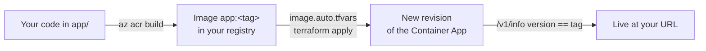

# FY26 · Deploy and operate your service

## What a release is



`course.deploy()` in [course.py](../../../fy26/course.py) does exactly this:

1. Picks a tag such as `v20261103-141502`.
2. `az acr build --registry <acr_name> --image app:<tag> --no-logs .` builds the [Dockerfile](../../../fy26/Dockerfile) **in Azure** (no Docker needed on your laptop). Only `pyproject.toml`, `uv.lock` and `app/` are sent to the build.
3. Writes `infra/image.auto.tfvars` with `image_tag = "<tag>"` and runs `terraform apply`. Terraform stays the single source of truth for what runs.
4. Polls `<url>/v1/info` until `version` equals the new tag. Container Apps keeps the old revision serving until the new one is healthy, so a broken build never takes your URL down.

It takes 4 to 6 minutes. Why so careful: if you deploy by hand and skip step 4, you may score the *old* revision and think your change did nothing.

## Before you deploy

A deploy costs minutes; a local check costs seconds. From `fy26/`:

```bash
uv run pytest                                          # offline, seconds
uv run python -m harness check --week <N> --in-process # real models, 1 to 3 min
```

If the in-process harness crashes or scores 0 on `core.health`, the container will too.

## Deploy

| From | Command |
|---|---|
| Notebook (the lab's Deploy part) | `url = course.deploy()` |
| Terminal, in `fy26/` | `uv run python -c "import course; course.setup(); course.deploy()"` |

Then score the live URL: `course.check(<week>)` or `uv run python -c "import course; course.setup(); course.check(<week>)"`. To confirm from a browser, the course website has **Score your deployed service** (same public checks).

## Inspect the live service

Get your names from Terraform first (from `fy26/`):

```bash
RG=$(terraform -chdir=infra output -raw resource_group_name)
APP=$(terraform -chdir=infra output -raw container_app_name)
URL=$(terraform -chdir=infra output -raw app_url)
```

On Windows PowerShell: `$RG = terraform -chdir=infra output -raw resource_group_name` (same for the others), then use `$RG`.

| Question | Command |
|---|---|
| Is it up? | `curl -s $URL/health` then `curl -s $URL/v1/info` (shows `version`, `model`, `student_id`) |
| Is it configured? | `curl -s $URL/ready`: 503 lists the missing settings |
| Which revisions exist, which is active? | `az containerapp revision list -n $APP -g $RG -o table` |
| What did my code print? | `az containerapp logs show -n $APP -g $RG --type console --tail 100` |
| Why did the revision not start? | `az containerapp logs show -n $APP -g $RG --type system --tail 100` |
| Watch live while the harness runs | add `--follow` |
| Which tags have I built? | `az acr repository show-tags -n $(terraform -chdir=infra output -raw acr_name) --repository app -o table` |

Every response carries an `X-Request-ID` header, and 500 and 503 errors return `{"detail": ..., "request_id": ...}`. Search the console logs for that id to find the traceback.

## Roll back

Write the previous good tag into `infra/image.auto.tfvars` (`image_tag = "v2026..."`), then `terraform -chdir=infra apply`. A new revision runs the old image. No rebuild needed.

## Change the infrastructure

Edit the `.tf` file (one concept per file, see [infra/README.md](../../../fy26/infra/README.md)), then:

```bash
terraform -chdir=infra plan    # read it: + create, ~ update in place, -/+ replace (destroys first!)
terraform -chdir=infra apply
```

Stop and think before applying any `-/+` on the Foundry account or the Container Apps environment. Run `terraform fmt -recursive infra` before you commit `.tf` changes.

## Week 10: turn on the API key

```python
course.set_api_key()   # writes infra/secrets.auto.tfvars and SERVICE_API_KEY in .env (both gitignored)
url = course.deploy()  # Terraform stores the key as a Container Apps secret
```

From then on `/v1/*` and `/mcp` need the `X-API-Key` header; `/health`, `/ready`, `/v1/info` and `/docs` stay open. `course.check` sends the key for you.

To call a protected route with `curl`, load the key into the shell without printing it, then reference the variable:

```bash
export "$(grep '^SERVICE_API_KEY=' .env)"     # bash or zsh; prints nothing
curl -s -X POST $URL/v1/chat -H "content-type: application/json" -H "X-API-Key: $SERVICE_API_KEY" -d '{"message":"hi"}'
```

On Windows PowerShell: `$env:SERVICE_API_KEY = ((Get-Content .env | Select-String '^SERVICE_API_KEY=').Line -split '=', 2)[1]`, then use `curl.exe` with `-H "X-API-Key: $env:SERVICE_API_KEY"`.

## Traces and KQL

Application Insights receives traces 2 to 5 minutes after the requests. Query from `fy26/`:

```bash
az extension add --name log-analytics --upgrade --only-show-errors   # once: the query command is an extension
WS=$(terraform -chdir=infra output -raw log_analytics_workspace_id)
az monitor log-analytics query -w $WS --analytics-query "AppRequests | where TimeGenerated > ago(30m) | summarize count(), percentile(DurationMs, 95) by Name" -o table
```

`AppRequests`, `AppDependencies` (model calls) and `AppExceptions` are the useful tables. The Week 10 lab, Part 5, has more queries.

## Cost and lifetime

The app scales to zero (`min_replicas = 0`): the first request after idle takes 30 to 45 seconds, and the harness absorbs it. Keep the service running until grades are posted. Delete everything only at the end of the course, deliberately: `terraform -chdir=infra destroy`.

## Learn more

- [Revisions in Azure Container Apps](https://learn.microsoft.com/en-us/azure/container-apps/revisions)
- [Log streaming and log options in Container Apps](https://learn.microsoft.com/en-us/azure/container-apps/log-streaming)
- [Build images in Azure with ACR Tasks (`az acr build`)](https://learn.microsoft.com/en-us/azure/container-registry/container-registry-quickstart-task-cli)
