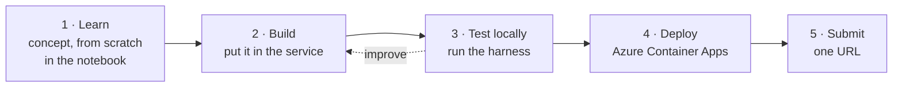
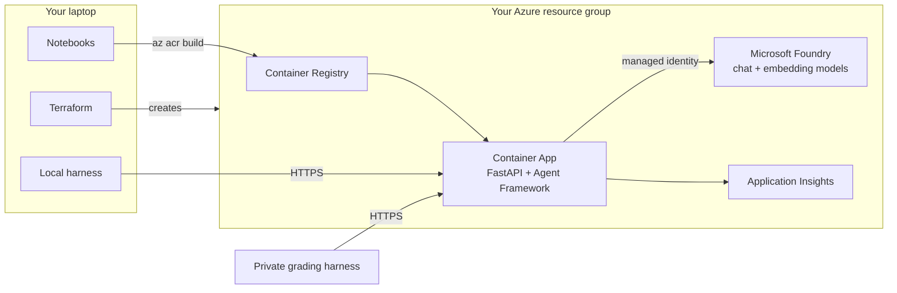

# FY26 · Agentic AI on Microsoft Foundry

By **Pablo Salvador Lopez** ([@pablosalvador10](https://github.com/pablosalvador10)).

Over five sessions you build, deploy and harden one AI service: a support assistant for **Lakeshore Ride**, a fictional bike-share company. Each week adds one capability, and each week ends the same way: your service is running in Azure and a harness scores it.

**Student entry point:** open the [course home](index.html) in a browser for the setup sequence and direct links to every lecture, slide deck and lab. The main lab is the core work; deep dives are optional extensions, not another required assignment.

**Jump to:** [Calendar](#calendar) · [How every week works](#how-every-week-works) · [The stack](#the-stack-as-of-october-2026) · [What you build](#what-you-build) · [Start here](#start-here) · [Grading](#grading) · [Folder map](#folder-map)

## Calendar

| Week | Date | Topic | Materials |
|---|---|---|---|
| 1 | Sep 29 | Azure Cloud Fundamentals + Compute + Storage | |
| 2 | Oct 6 | Data and Analytics | |
| 3 | Oct 13 | Apps and DevOps | |
| 4 | Oct 20 | Security, Monitoring and Observability | |
| **5** | **Oct 27** | **Fundamentals of Azure AI** | [Week 5](week05-fundamentals-of-azure-ai/README.md) |
| **6** | **Nov 3** | **RAG Apps + Tool Calling** | [Week 6](week06-rag-and-tool-calling/README.md) |
| **7** | **Nov 10** | **Multi-Agent Systems** | [Week 7](week07-multi-agent-systems/README.md) |
| **8** | **Nov 17** | **Harnesses and Agentic Coding** | [Week 8](week08-harnesses-and-agentic-coding/README.md) |
| 9 | Nov 24 | Fabric Data Agents + Semantic Model + Ontology | |
| **10** | **Dec 1** | **Production Agentic Systems** | [Week 10](week10-production-agentic-systems/README.md) |

Weeks in **bold** have their materials here. Before Week 5, complete [Setup](setup/README.md).

## How every week works

Every session is four hours and follows the same loop, so you spend your attention on the ideas, not on the mechanics.



1. **Learn.** Each concept is first built from scratch in plain Python, so you see what the frameworks do for you.
2. **Build.** The same idea goes into the service in `app/`. The starting code works but is naive on purpose.
3. **Test locally.** The harness calls your service and scores it. It shows exactly what failed and why.
4. **Deploy.** One notebook cell builds your image in Azure and rolls out a new revision.
5. **Submit.** You hand in a single URL. We run a private version of the harness against it.

Plan your time around what waits on Azure:

| Step | Typical time |
|---|---|
| One model call | 1 to 5 s |
| Harness run, in-process | 1 to 3 min |
| Deploy (build the image, roll out a revision) | 4 to 6 min |
| Harness run against your URL | 2 to 5 min |
| Traces visible in Application Insights | 2 to 5 min after the requests |

Every lab marks a point where you stop improving and deploy. A deployed improvement counts; an undeployed one does not.

## The stack, as of October 2026

| Layer | What you use | Why this one |
|---|---|---|
| Models | `gpt-5.4-mini` and `text-embedding-3-small` on **Microsoft Foundry**, through the **Responses API** (OpenAI Python SDK) | One API shape for OpenAI and Azure; keyless with Entra ID |
| Agents | **Microsoft Agent Framework** 1.23 | Tools, structured output, workflows, approvals, tracing |
| Tools for other agents | **MCP**, revision 2026-07-28 (MCP Python SDK 2.x) | The standard way agents discover and call tools |
| Service | **FastAPI** on **Azure Container Apps** | A plain HTTP contract; scales to zero |
| Infrastructure | **Terraform** (`azurerm` 5.x) | Your whole environment, reviewable and repeatable |
| Observability | **OpenTelemetry** into **Application Insights** | Standard traces for agents, model calls and tools |

The field moves monthly. Each week's README links the current official documentation; when a link and this course disagree, trust the link and tell us. If you want a credential afterwards, the course covers much of [Azure AI Apps and Agents Developer Associate (AI-103)](https://learn.microsoft.com/en-us/credentials/certifications/azure-ai-apps-and-agents-developer-associate/), and Week 7 points to the expert-level [AI-500](https://learn.microsoft.com/en-us/credentials/certifications/exams/ai-500/).

## What you build

One service, one URL, five capabilities. The contract (routes and JSON shapes) is fixed; how you implement it is up to you.

| Week | Route | Capability | Technique you learn |
|---|---|---|---|
| 5 | `POST /v1/classify`, `/v1/chat` | Triage support tickets | Models, prompts, structured output, Entra ID auth |
| 6 | `POST /v1/ask` | Answer from the handbook, with citations | Embeddings, retrieval (RAG), tool calling, agents |
| 7 | `POST /v1/resolve` | Resolve cases: credits, tickets, replies | Multi-agent orchestration, structured routing, approvals |
| 8 | `POST /mcp` | Publish your tools to any agent; build a new one | MCP, agent harnesses, coding agents, spec-driven tests |
| 10 | all of the above | Survive real traffic and real attackers | Guardrails, limits, auth, tracing, evaluation |



## Start here

1. Complete [Setup](setup/README.md) (about 45 minutes): tools, Azure sign-in, Terraform, first deployment. If a step fails, the course agents can help: see [Your course agents](foundations/docs/agents.html).
2. If a tool is new to you, read its primer in [Foundations](foundations/README.md). Each takes 15 to 20 minutes. All five are also on [one page](foundations/docs/primers.html).
3. Before each session, read the week's README and its lecture notes (`lecture.md`). In class, open its `lab.ipynb`.
4. Each week's `docs/` folder has the same notes in two browser formats: `docs/lecture.html`, one long page with a contents column on the left (print it to PDF with the button at the top), and `docs/slides.html`, one idea per slide (arrow keys to move; `C` contents, `F` full screen, `P` print to PDF).

Every command in this course runs from the `fy26/` folder. The notebooks switch to it for you.

**Stuck?** In VS Code, open Copilot Chat and pick an agent from the Agent dropdown. The course has five: **Pablo · Start here** (when you are lost; it asks the experts for you), **Pablo · Fundamentals** (the AI, the lectures, the labs, hints on the fix), **Pablo · Scoring** (your score, how grading works, the course website, the check before you submit), **Will · Infra and deploy** (setup, Azure, Terraform, Container Apps, deploying, logs) and **Arvind · Data** (the handbook and station data, harness datasets and reports, evaluation, telemetry). They explain and give hints; the graded code is yours, whether you type it or direct Copilot's Agent. [Your course agents](foundations/docs/agents.html) shows how to call them and how to vibe code well.

## Grading

- Each week you submit **one URL**: your Container App, by the deadline in the week's README.
- We run the private harness on it: the same engine as yours, with more, unseen data. Write rules that generalize; answers tuned to the public questions do not transfer.
- Your local harness score is a good predictor, not a promise. Models vary between runs: treat a difference of one or two points as noise.
- On the course website (sign in with the GitHub account that has access to this repository), **Score your deployed service** runs the same public harness against your URL and shows what to fix next. Use it to confirm a deployment; iterate locally in between.
- The service is cumulative. Later weeks must keep earlier routes working; your final URL is scored with every week's harness.
- Keep your service running until grades are posted. It scales to zero when idle, so the cost is small; the harness's first check absorbs the slow first request after idle.

## Folder map

```
fy26/
├── setup/            Start here: tools, Azure, Terraform, first deployment
├── foundations/      Start here: how to use the course agents (docs/agents.html), then short primers on Terraform, FastAPI, containers, identity and the harness (docs/primers.html)
├── week05-…/         One folder per session: README (start here), lecture.md (the notes), lab.ipynb, deep-dive.ipynb (optional)
│   └── docs/         The notes for the browser: lecture.html (one page) and slides.html (for class)
├── assets/           Shared style and scripts for the lecture pages and slide decks
├── app/              The service you deploy (FastAPI, Microsoft Agent Framework)
├── harness/          The local harness: checks and public data
├── infra/            Terraform for your resource group
├── tests/            Fast tests that run offline (uv run pytest)
├── web/              The course website: lectures behind GitHub sign-in, plus the online harness
├── course.py         Notebook helpers; each one prints the command it runs
├── Dockerfile        How your image is built
└── AGENTS.md         Instructions for coding agents working in this folder (Week 8)
```

Last year's labs are archived, unchanged, in [FY25](../fy25/README.md).
