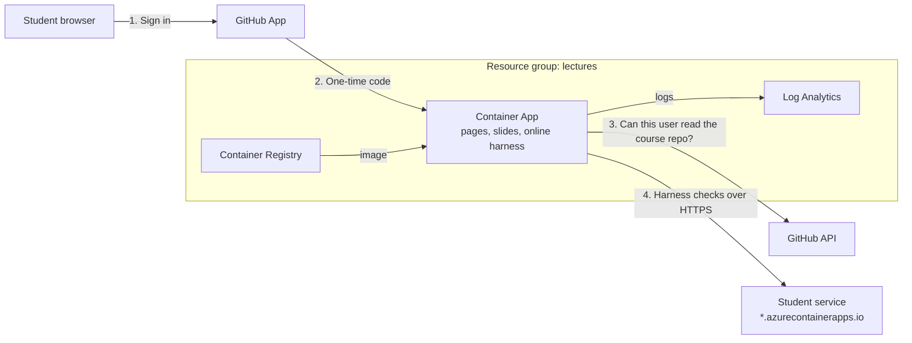

# Course website

One URL for the whole course: the course home, every lecture and slide deck, every README, lecture note, lab and deep-dive notebook, handbook page and source file, and **Score your deployed service**, a page where students paste their service URL and the same harness they run locally scores it, with the evidence and what to fix next. Students sign in with GitHub; anyone who can read the course repository gets in. It runs on Azure Container Apps in its own resource group, `lectures`.



## Set it up (once)

Run everything from `fy26/`, signed in with `az login` to the subscription that should pay for the site.

**1. Create the platform.** It gives you the address the GitHub App needs.

```bash
cp web/infra/terraform.tfvars.example web/infra/terraform.tfvars   # set subscription_id
terraform -chdir=web/infra init
terraform -chdir=web/infra apply
terraform -chdir=web/infra output     # site_url, github_callback_url
```

**2. Create the GitHub App** at [github.com/settings/apps/new](https://github.com/settings/apps/new) (or under the organization that owns the course repository):

| Field | Value |
|---|---|
| Homepage URL | `site_url` |
| Callback URL | `github_callback_url`. Add `http://localhost:8000/auth/callback` as a second one to run the site locally |
| Expire user authorization tokens | On (default) |
| Request user authorization (OAuth) during installation | Off |
| Webhook → Active | Off |
| Permissions | **Repository permissions → Metadata: Read-only**, nothing else. Without it the app cannot see any repository, the installation shows "No repositories", and every sign-in is refused |
| Where can this GitHub App be installed? | **Any account**. A private app can only be authorized by members of the account that owns it, so students could not sign in. The site never uses an installation other than the course repository's, so someone installing it elsewhere changes nothing |

Create it, copy the **Client ID**, and **Generate a new client secret**. Then **Install App** on the account that owns the course repository, with **Only select repositories** → the course repository. The access check asks GitHub, with the student's own token, whether the student can see that repository; without the installation the answer is always no. If you add the Metadata permission after installing, accept the new permission under **Settings → Applications → Installed GitHub Apps → Configure**, and select the repository there.

Put both values in `web/infra/terraform.tfvars` (gitignored):

```hcl
github_client_id     = "Iv23li..."
github_client_secret = "..."
```

**3. Publish.** This stages the build context in `web/build/`, builds the image in the registry, applies Terraform with the new tag, and waits until the site answers with it:

```bash
uv run python -m web.publish
```

**4. Give students access** the same way they get the code: invite them to the course repository, or add them to the organization team that can read it. Share `site_url`. Students sign in with GitHub and land on the course home.

## Day to day

| Task | How |
|---|---|
| Publish new lectures or slides | Commit them, then `uv run python -m web.publish`. The pages are baked into the image, so every version is a tag you can roll back to |
| Remove a student | Remove their repository access. Sessions end within 8 hours (`session_hours`) |
| Rotate the client secret | Generate a new one in the GitHub App, update `terraform.tfvars`, `terraform -chdir=web/infra apply`. Everyone signs in again |
| See runs and sign-ins | `az containerapp logs show -n <container_app_name> -g lectures --follow`. Each run logs user, week, target, status, score and duration |
| Keep the site warm during the term | `min_replicas = 1` in `terraform.tfvars`, then apply. With 0 the first visit after idle waits about 15 s |
| Remove everything | `terraform -chdir=web/infra destroy` |

Cost: Container Apps consumption (scales to zero), a Basic registry, and Log Analytics capped at 1 GB a day.

## How it works

| Concern | Choice | Why |
|---|---|---|
| Hosting | Container Apps, at most one replica ([containerapp.tf](infra/containerapp.tf)) | The online harness needs a server, and harness runs are queued in that replica's memory |
| Sign-in | GitHub App OAuth with `state` and PKCE ([auth.py](auth.py)) | Container Apps' built-in authentication has no Terraform resource in `azurerm` 5.x and cannot tell who may read a repository |
| Who gets in | The user's token can read `course_repo` | Access follows the repository: no second roster to maintain |
| Session | Signed cookie with the login only, 8 h, `HttpOnly`, `Secure`, `SameSite=Lax`; signing out is a `POST` | The GitHub token is dropped after sign-in; nothing to steal from the server. A sign-out link would let crawlers, link prefetching or another site end the session |
| What is served | Lecture pages and slide decks as they are (`assets/`, `docs/`); every README, lecture note, notebook and source file rendered as a documentation page with a course sidebar, an "On this page" column and search (`Ctrl K` / `⌘K`) ([shell.py](shell.py), [render.py](render.py), [site.py](site.py)). The home page and the sidebar are built from the week folders ([catalog.py](catalog.py)): date from each README, title and "You build" from each lecture page | The whole course reads in one place, and a new week appears without editing the site. Notebooks are read-only (no outputs are committed) with a download button; diagrams are drawn by Mermaid 12.2.0, pinned and checksum-verified in the [Dockerfile](Dockerfile) |
| What is never served | Hidden files (`.env`), Terraform variables and state, `reports/`, `web/`, caches; the image is built entirely from the last commit (`git archive HEAD`: course files, site code, harness, lock file), so uncommitted edits stay on your laptop | An allowlist of folders and file types, so a stray secret, scratch file or half-finished edit cannot be published |
| Online harness | The same engine as `python -m harness check --url` ([runs.py](runs.py)) | Students see the score and evidence they would see locally |
| Which URLs it calls | `https`, `*.azurecontainerapps.io`, public IP addresses only | Otherwise the site could be pointed at addresses inside Azure (server-side request forgery) |
| Fair use | Three runs at once, one per student, 20 per student per hour | One student cannot block the queue before a deadline |
| API key (Week 10) | Sent to the student's service for that run only; never stored, logged or echoed | It is the student's secret |

The page uses the public harness data. Grades come from the private pack, so a score of 100 here means every check passes on the public cases, which is the best predictor a student has.

## Run it locally

```bash
LECTURES_GITHUB_CLIENT_ID=... LECTURES_GITHUB_CLIENT_SECRET=... \
LECTURES_COURSE_REPO=owner/name \
uv run uvicorn --factory web.main:create_app --reload
uv run pytest tests/test_web.py      # offline: GitHub is faked
```
