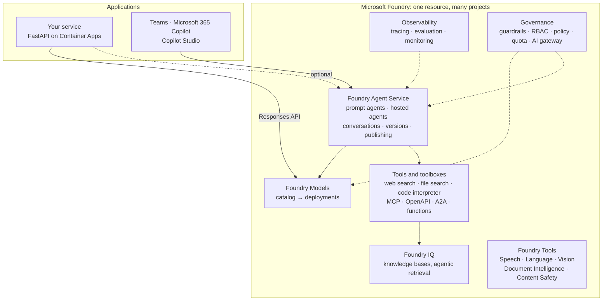
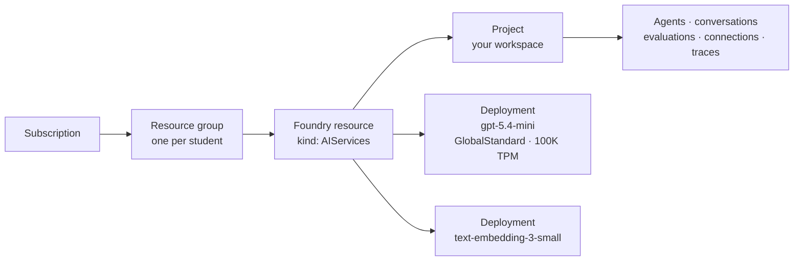
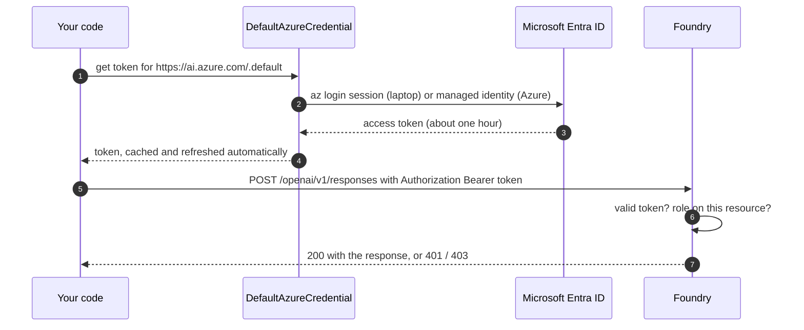
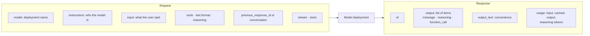
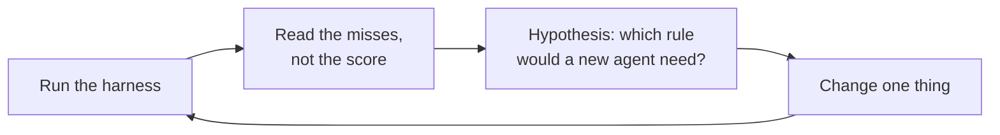
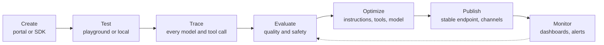
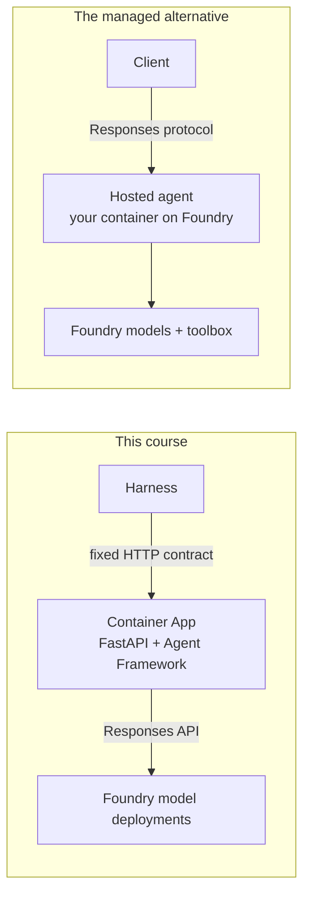

# Week 5 · Lecture notes: Fundamentals of Azure AI

[← Week 5 overview](README.md) · [Lab](lab.ipynb) · [Deep dive (optional)](deep-dive.ipynb) · [FY26 home](../README.md)

These notes are the content of the session. The [README](README.md) has the logistics and the exercise; the [lab](lab.ipynb) has the code you run. Read the notes in order: each section builds on the previous one, and each ends with where it shows up in your service.

**Contents**

1. [The Azure AI stack in one picture](#1--the-azure-ai-stack-in-one-picture)
2. [The resource model: resource, project, deployment, endpoint](#2--the-resource-model-resource-project-deployment-endpoint)
3. [Choosing a model](#3--choosing-a-model)
4. [Deployment types, quota and throttling](#4--deployment-types-quota-and-throttling)
5. [Identity: keyless by design](#5--identity-keyless-by-design)
6. [The Responses API, piece by piece](#6--the-responses-api-piece-by-piece)
7. [Tokens, cost and latency](#7--tokens-cost-and-latency)
8. [Structured output: from prose to contracts](#8--structured-output-from-prose-to-contracts)
9. [Prompts as code, improved by measurement](#9--prompts-as-code-improved-by-measurement)
10. [Foundry Agent Service](#10--foundry-agent-service)
11. [Safety from the first call](#11--safety-from-the-first-call)
12. [Summary](#12--summary)

---

## 1 · The Azure AI stack in one picture

Microsoft Foundry is Azure's platform for building with AI. It is one Azure resource that holds models, agents, tools, knowledge, evaluation and governance, with one identity model, one network boundary and one bill.



| Layer | What it gives you | Where you meet it in this course |
|---|---|---|
| **Foundry Models** | A catalog of thousands of models (OpenAI, Microsoft, Meta, Mistral, DeepSeek, Anthropic and others). You *deploy* the ones you use. | Week 5: `gpt-5.4-mini` and `text-embedding-3-small` |
| **Foundry Tools** (formerly Azure AI Services) | Pre-built, task-specific AI: speech, translation, vision, document extraction, content safety | Week 10: Content Safety classifiers power the guardrails |
| **Foundry Agent Service** | A managed runtime for agents: definitions, versions, conversations, tools, identity, publishing | Week 5 (concepts), Week 8 (MCP), Week 10 (guardrails, evaluation) |
| **Tools and toolboxes** | Built-in tools, plus a way to curate tools once and share them behind one MCP endpoint | Weeks 6 and 8 |
| **Foundry IQ** | Managed, permission-aware knowledge bases with agentic retrieval, built on Azure AI Search | Week 6: the managed version of what you build from scratch |
| **Observability** | OpenTelemetry tracing, built-in evaluators, continuous evaluation, dashboards | Week 10 |
| **Governance** | Guardrails, RBAC, Azure Policy, quota, AI gateway, fleet inventory (the Foundry control plane) | Weeks 5 and 10 |

**Why one platform?** Until 2025, Azure OpenAI, Azure AI Services and hub-based AI Studio projects were separate resources with separate endpoints, SDKs and permissions. The current model consolidates them. You will still read the old names in blog posts and answers online, so keep this translation table at hand:

| Previous name or design | Current |
|---|---|
| Azure AI Studio, Azure AI Foundry | Microsoft Foundry |
| Azure AI Services | Foundry Tools |
| Hub + Azure OpenAI + AI Services resources | One Foundry resource with projects |
| Assistants API: threads, messages, runs, assistants | Responses API: conversations, items, responses, agent versions |
| Monthly `api-version` query parameters | Stable v1 routes (`/openai/v1/`) |
| `azure-ai-inference`, `AzureOpenAI()`, five or more endpoints | `azure-ai-projects` 2.x plus the standard `OpenAI()` client, against one project |

Source: [What is Microsoft Foundry?](https://learn.microsoft.com/en-us/azure/foundry/what-is-foundry)

---

## 2 · The resource model: resource, project, deployment, endpoint



- **Foundry resource** (`Microsoft.CognitiveServices/accounts`, kind `AIServices`). The security and billing boundary: networking, managed identity, local authentication on or off, deployments and their quota.
- **Project.** A workspace inside the resource for one application or team. Agents, files, evaluations, connections and traces live here. Access can be granted per project.
- **Deployment.** A named instance of one model version, with a deployment type (SKU) and a capacity. Your code calls the **deployment name**, not the model name. Pointing an existing deployment name at a newer model version is how you upgrade without touching code.
- **Endpoints.** One resource exposes two families of URLs:

| Endpoint | Shape | Used by |
|---|---|---|
| OpenAI-compatible v1 | `https://<resource>.openai.azure.com/openai/v1/` | Any OpenAI SDK: Responses, embeddings. Our `app/models.py` |
| Project | `https://<resource>.services.ai.azure.com/api/projects/<project>` | `azure-ai-projects`, Agent Framework (`FoundryChatClient`): agents, conversations, evaluations |

The Terraform in [`infra/foundry.tf`](../infra/foundry.tf) creates exactly this:

| Concept | Terraform resource | Settings worth reading |
|---|---|---|
| Foundry resource | `azurerm_cognitive_account.foundry` | `kind = "AIServices"`, `project_management_enabled = true`, `local_auth_enabled = false` |
| Project | `azurerm_cognitive_account_project.this` | System-assigned identity |
| Chat deployment | `azurerm_cognitive_deployment.chat` | `sku.name = "GlobalStandard"`, `capacity = 100` |
| Embedding deployment | `azurerm_cognitive_deployment.embedding` | `depends_on` the chat deployment: an account accepts one deployment change at a time |

**Why `local_auth_enabled = false`?** An API key is a bearer secret: whoever holds it is you, it does not expire on its own, and it ends up in notebooks, screenshots and git history. With keys disabled, every caller must present a Microsoft Entra ID token. Access becomes per identity, auditable and revocable. Section 5 shows how.

**In your service:** `FOUNDRY_OPENAI_ENDPOINT` and `FOUNDRY_PROJECT_ENDPOINT` in `.env` are Terraform outputs; Lab Part 1 prints them and lists your deployments.

---

## 3 · Choosing a model

There is no best model, only the best model for a task at a price. Compare candidates on these dimensions:

| Dimension | Question to ask | Why it matters here |
|---|---|---|
| Capability | Does it do the task: structured output, tool calling, vision, audio? | Triage needs structured output; Week 6 needs tool calling |
| Size tier | Flagship, mini or nano? | Smaller is faster and cheaper, and often enough for classification |
| Reasoning | Does it think before it answers, and can you set the effort? | Better on multi-step problems; costs reasoning tokens and time |
| Context window | How many tokens fit in one request? | Long documents, long conversations, many tools |
| Price | Input, cached input and output are priced separately | Output tokens usually cost several times more than input tokens |
| Availability | Which regions and deployment types? | Data residency and quota |
| Lifecycle | When does this version retire? | You will have to upgrade, and re-evaluate |

**A rule that saves money:** start with the smallest model that passes your harness. Move up a tier only when a measured failure requires it, and keep the measurement.

**The catalog in October 2026.** Foundry sells OpenAI's newest series directly: GPT-6.1 and GPT-6 (`gpt-6.1-sol`, `gpt-6-astra`, `gpt-6-sol`, `gpt-6-luna`), GPT-5.6 (`gpt-5.6-sol`, `-terra`, `-luna`), GPT-5.5, and the GPT-5.4 tiers (`gpt-5.4-pro`, `gpt-5.4`, `gpt-5.4-mini`, `gpt-5.4-nano`), next to open-weight `gpt-oss` and models from other providers. This course runs on **`gpt-5.4-mini`** (version 2026-03-17): it has everything the service needs (Responses API, structured outputs, parallel tool calls, reasoning effort), a 400,000-token context window, and a price that lets every student run the harness many times. The newest flagship is not the right default for picking one of six labels; it is a candidate to measure when a failure calls for it. See [Foundry Models sold directly by Azure](https://learn.microsoft.com/en-us/azure/foundry/foundry-models/concepts/models-sold-directly-by-azure).

**Reasoning models.** Models such as the GPT-5 family generate hidden reasoning before the visible answer. You control how much with `reasoning={"effort": ...}`, from `none` up to `high`. More effort helps on multi-step problems (pricing rules with exceptions, plans, code) and wastes time on simple ones (picking one of six categories). Measure both.

**Model lifecycle.** Every model version has a retirement date. A deployment can follow the default version automatically or stay pinned. In production, pin the version, evaluate the new one against your harness, then switch. See [model retirements](https://learn.microsoft.com/en-us/azure/foundry/openai/concepts/model-retirements).

**Model router.** Foundry also offers a model router: one deployment that picks a model per request based on its difficulty. It trades predictability for cost. Try it in *Go further*, and measure whether your accuracy holds.

---

## 4 · Deployment types, quota and throttling

A deployment type decides **where your prompts are processed**, **how you pay** and **how predictable latency is**.

| Deployment type | SKU in code | Data processed in | Billing | Best for |
|---|---|---|---|---|
| Global Standard | `GlobalStandard` | Any Azure region | Per token | Default: newest models, lowest price, highest quota |
| Global Provisioned | `GlobalProvisionedManaged` | Any Azure region | Reserved PTUs | High, steady volume with low latency variance |
| Global Batch | `GlobalBatch` | Any Azure region | Per token, 50% off, 24-hour target | Large offline jobs |
| Data Zone Standard | `DataZoneStandard` | Inside the US, EU or APAC data zone | Per token | Data-zone compliance |
| Data Zone Provisioned | `DataZoneProvisionedManaged` | Inside the data zone | Reserved PTUs | Data zone plus predictable throughput |
| Data Zone Batch | `DataZoneBatch` | Inside the data zone | 50% off | Offline jobs with residency needs |
| Standard | `Standard` | Inside one Azure geography | Per token | Geography compliance, low volume |
| Regional Provisioned | `ProvisionedManaged` | Inside one Azure geography | Reserved PTUs | Geography compliance plus throughput |
| Developer | `DeveloperTier` | Any region | Per token, no SLA | Evaluating fine-tuned models (24-hour lifetime) |

Data at rest stays in your resource's geography for every type; the table is about where **inference** runs. Global Standard also supports request-level tiers: *flex* processing (cheaper, delay-tolerant) and *priority* processing (faster, pay as you go). We use Global Standard: you are students in one region with bursty traffic, and you want the newest models.

**Quota.** Standard deployments have two limits that come from one number: **tokens per minute (TPM)** and **requests per minute (RPM)**. In Terraform, `capacity` is in thousands of TPM, so our `capacity = 100` gives 100,000 TPM and, for `gpt-5.4-mini`, 100 requests per minute (the deep dive reads both from your deployment). Quota is granted per subscription, region and model, and you split it among deployments.

A back-of-the-envelope calculation you should be able to do. The starting triage call measures about 170 input tokens (short instructions plus the ticket) and 40 output tokens, about 210 in total; with the detailed rules you write in the lab it grows to roughly 700. The token limit alone would allow

$$\frac{100{,}000}{210} \approx 476 \quad\text{or}\quad \frac{100{,}000}{700} \approx 140 \text{ calls per minute}$$

but the request limit stops you at 100 either way. The break-even is $100{,}000 / 100 = 1{,}000$ tokens per call: below it, **requests bind first**; above it (big contexts, many tools), **tokens** do. A Week 7 case that makes eight model calls, each with a longer context, uses both budgets eight times faster. That is why multi-agent systems hit limits first.

**Throttling.** Over the limit, Foundry answers **HTTP 429** with a `Retry-After` header. A well-behaved client waits that long, retries with exponential backoff and jitter, and gives up after a few attempts. Our middleware turns an upstream 429 into **503 with `Retry-After`**, so callers know the problem is temporary capacity, not their request ([`app/middleware.py`](../app/middleware.py)).

**Provisioned throughput.** A PTU buys reserved model capacity at a fixed hourly price. It pays off when traffic is high and steady, or when you need low latency variance. Below that, pay-per-token is cheaper. See [provisioned throughput](https://learn.microsoft.com/en-us/azure/foundry/openai/concepts/provisioned-throughput).

Source: [Deployment types in Microsoft Foundry Models](https://learn.microsoft.com/en-us/azure/foundry/foundry-models/concepts/deployment-types)

---

## 5 · Identity: keyless by design



- **`DefaultAzureCredential`** tries a chain of identity sources and uses the first that works: environment variables, workload identity, **managed identity**, then developer tools such as the **Azure CLI**. On your laptop it finds `az login`; in Container Apps it finds the app's managed identity. The same code runs in both places.
- **Token audience.** The token is issued for `https://ai.azure.com/.default`. A token for another service, such as Storage, is rejected.
- **Authorization is RBAC.** A valid token is not enough; the identity needs a role on the resource. Foundry's built-in roles were recently renamed:

| Role (previous name) | Can do | Who has it here |
|---|---|---|
| **Foundry User** (Azure AI User) | Call models, use agents and project data: the data plane | You, and your Container App's managed identity |
| **Foundry Project Manager** (Azure AI Project Manager) | Manage a project and assign Foundry User within it | Nobody in this course |
| **Foundry Owner** (Azure AI Owner) | Full access to projects and resources | Nobody |
| **Foundry Account Owner** (Azure AI Account Owner) | Manage the Foundry resource: deployments, guardrails, connections | Nobody explicitly; you have these rights as Owner of your subscription |

Notice the split between the **control plane** (Azure Resource Manager: create a deployment, change a guardrail) and the **data plane** (call a model). The running service needs only the data plane, so its identity gets only Foundry User: if it is compromised, it cannot create deployments or change safety settings. See [`infra/identity.tf`](../infra/identity.tf) and [RBAC for Microsoft Foundry](https://learn.microsoft.com/en-us/azure/foundry/concepts/rbac-foundry).

**Agents get identities too.** Foundry agents receive their own Microsoft Entra *agent identity*, so a tool call is authorized as the agent, not as a shared key. Week 10 returns to this.

**In your service:** `FoundryModels.__init__` in [`app/models.py`](../app/models.py) builds the client with `get_bearer_token_provider(DefaultAzureCredential(), TOKEN_SCOPE)`. There is no key anywhere in the repository, by design.

---

## 6 · The Responses API, piece by piece

The **Responses API** is the interface to every Foundry model in this course. One request carries instructions, input and options; one response carries typed output items and token usage.



```python
from azure.identity import DefaultAzureCredential, get_bearer_token_provider
from openai import OpenAI

token = get_bearer_token_provider(DefaultAzureCredential(), "https://ai.azure.com/.default")
client = OpenAI(base_url=FOUNDRY_OPENAI_ENDPOINT, api_key=token)  # api_key accepts a token provider

r = client.responses.create(
    model="gpt-5.4-mini",  # the deployment name
    instructions="You are Lakeshore Ride support. One sentence.",
    input="Can I end my ride at any station?",
    reasoning={"effort": "low"},
)
print(r.output_text)
print(r.usage.input_tokens, r.usage.output_tokens, r.usage.output_tokens_details.reasoning_tokens)
```

**`instructions` versus `input`.** Instructions say who the model is and how it behaves; you write them, they are stable, they are trusted. Input is what the user said; it changes every request and is never trusted. Keeping them apart matters for caching (section 7) and for security (Week 10).

**Output items, not one string.** A response is a list of typed items: `message`, `reasoning`, `function_call`, and the outputs of built-in tools. `output_text` concatenates the text for you. In Week 6 you will read `function_call` items yourself.

**Conversation state.** The model is stateless; every call stands alone. You have three ways to carry a conversation:

| Approach | How | Trade-off |
|---|---|---|
| Client-side history | Resend all previous messages as `input` | Full control, nothing stored server-side; you manage truncation |
| `previous_response_id` | Point at the last response; the service chains the history | Simple; requires `store=True` (the default) and server-side retention |
| Conversations API | Create a durable `conversation` object and attach responses to it | Shared across clients and channels; this is what Foundry agents use |

Server-side state is convenient, but it does not make history free: the whole history is still processed as input tokens on every turn. Long conversations get slower and more expensive until you summarize or truncate them.

**Streaming.** With `stream=True` the API sends **events** as the response is produced: `response.created`, many `response.output_text.delta`, then `response.completed`. The total time does not change; the time to first visible word does. For a chat UI that is the difference between "fast" and "broken"; for a JSON API such as `/v1/classify` it buys nothing.

**Why Responses rather than Chat Completions?** Chat Completions is still supported, but the Responses API models what agents need: typed items, server-side state, built-in tools and reasoning that persists across turns. New platform features, including Foundry agents, are built on it. The older Assistants API (threads and runs) is replaced by Responses plus Conversations.

---

## 7 · Tokens, cost and latency

A **token** is a piece of a word, about four characters of English. You pay per token, with separate prices for input, cached input and output. Reasoning tokens are billed as output.

For this course's text-only `gpt-5.4-mini` calls, the token charge is:

$$\text{cost} = (n_\text{input} - n_\text{cached}) \cdot p_\text{input} + n_\text{cached} \cdot p_\text{cached} + n_\text{output} \cdot p_\text{output}$$

Here $n_\text{input}$ is `usage.input_tokens`, $n_\text{cached}$ is `usage.input_tokens_details.cached_tokens`, and $n_\text{output}$ is `usage.output_tokens`. **These are totals with nested breakdowns:** cached tokens are already part of input, and reasoning tokens are already part of output. Do not add either breakdown again. The $p$ values above are prices per token; divide by 1,000,000 if your price table quotes prices per million tokens. Tool and hosting charges are separate.

See [reasoning token usage](https://learn.microsoft.com/en-us/azure/foundry/openai/how-to/reasoning#how-reasoning-works) and [prompt caching](https://learn.microsoft.com/en-us/azure/foundry/openai/how-to/prompt-caching) for the accounting rules.

Latency has two parts you can reason about separately:

$$\text{latency} \approx \underbrace{\text{time to first token}}_\text{queue, prompt processing, reasoning} + \frac{n_\text{visible output}}{\text{tokens per second}}$$

So the levers are:

| Lever | Effect on cost | Effect on latency |
|---|---|---|
| Shorter output (ask for one sentence, a JSON object, a label) | Large: output is the expensive side | Large: fewer tokens to generate |
| Lower reasoning effort | Fewer reasoning tokens | Shorter time to first token |
| Smaller model tier | Lower price per token | Usually faster |
| Stable prefix first, so it is **cached** | Cached input is discounted | Faster prompt processing |
| Fewer calls per request (Week 7) | Linear | Linear on the critical path |

**Prompt caching.** When the first 1,024 or more tokens of a request match a recent request, they are served from cache: cheaper and faster, with no code change. The rule that follows: put stable content (instructions, tool definitions, examples) first and the variable part (the user's message) last, and never put a timestamp or request id at the top. The lab measures it with `usage.input_tokens_details.cached_tokens`.

---

## 8 · Structured output: from prose to contracts

A service cannot parse prose. There are three levels of "please answer in JSON":

| Level | What the API guarantees | Failure mode |
|---|---|---|
| Ask in the prompt | Nothing | Sometimes prose, sometimes invalid JSON, sometimes the wrong fields |
| JSON mode | Valid JSON | Any shape: missing fields, invented values |
| **Structured outputs** (strict JSON Schema) | Valid JSON **that matches your schema** | The model can still refuse, or choose a wrong but valid value |

With structured outputs the schema constrains generation itself: the model cannot produce a token that would break the schema. You describe the schema with Pydantic, and the SDK converts it:

```python
from typing import Literal
from pydantic import BaseModel, Field


class TicketLabel(BaseModel):  # the real one is in app/contract.py
    category: Literal["billing", "bike_issue", "station_issue", "account", "safety", "other"]
    urgency: Literal["low", "medium", "high"]
    summary: str = Field(description="One sentence, at most 25 words.")


parsed = client.responses.parse(model=MODEL, instructions=RULES, input=ticket, text_format=TicketLabel)
label: TicketLabel = parsed.output_parsed
```

Four things to remember:

1. **`Literal` removes invention.** An enum in the schema means the model cannot create a seventh category.
2. **Field descriptions are prompt.** The model reads `description=...`; write it as an instruction.
3. **Shape is guaranteed, judgment is not.** Is a stuck dock `station_issue` or `bike_issue`? The schema cannot know; your instructions must say.
4. **Validate at the boundary anyway.** Refusals and truncated outputs happen. `FoundryModels.parse` retries once and then fails loudly; FastAPI validates the response model again before it leaves the service.

**A description is not a validator.** “At most 25 words” is a writing instruction for the model, not a Pydantic length constraint. Keep that concise target; the public schema check separately requires a non-empty summary of at most 300 characters. A valid shape does not prove that the category, urgency or summary is useful.

The literals above are the real `Category` and `Urgency` types from [`app/contract.py`](../app/contract.py), the contract the harness grades.

---

## 9 · Prompts as code, improved by measurement

Instructions are code. They live in git, they have bugs, and they need tests. A well-structured set of instructions for a classifier has:

| Part | Example for triage |
|---|---|
| Role and task | "You triage Lakeshore Ride support tickets." |
| Definitions | One line per category, with typical cases |
| Rules | When urgency is high, medium, low, stated so a person could apply them |
| Tie-breakers | "Safety beats everything. A refund request is billing, even if a broken bike caused it." |
| Output constraints | Length of the summary; no personal data |
| Examples (few-shot) | Three or four short tickets with their labels, chosen for the hard cases |

Then you improve it the way you improve any code:



Three disciplines make this work:

- **Change one thing at a time**, or you will not know what helped.
- **Know your noise.** Models are not deterministic; the same prompt can move a point or two between runs. One point is noise; five points is signal.
- **Do not overfit.** We grade on tickets you have not seen. A rule that names a public ticket's words is an answer, not a rule.

This loop (measure, read failures, change, measure) is the core skill of the course. Week 10 scales it with evaluators and LLM judges.

---

## 10 · Foundry Agent Service

So far: one call in, one answer out. An **agent** adds a loop: a model with instructions and **tools** decides, step by step, what to do next (call a tool, read the result, call another, answer) until the task is done. You build that loop yourself in Week 6. Foundry Agent Service is the managed platform for running agents.

### 10.1 · What the service gives you

| Component | What it does |
|---|---|
| **Agent runtime** | Hosts and scales agents; manages conversations, tool calls and the agent lifecycle |
| **Toolboxes** | Curate tools once (web search, file search, code interpreter, MCP servers, functions) and share them across agents through one managed MCP endpoint |
| **Models** | Any agent-capable model from the catalog; swap models without changing agent code |
| **Observability** | End-to-end traces, metrics and evaluations in Application Insights |
| **Optimization** | An agent optimizer (preview) that evaluates an agent and proposes better instructions, skills, tool descriptions and model choices, for prompt and hosted agents |
| **Identity and security** | An Entra ID identity per agent, RBAC, guardrails, virtual network isolation |
| **Publishing** | Versions, stable endpoints, distribution to Teams and Microsoft 365 Copilot, the Entra agent registry, and the A2A protocol |

### 10.2 · Three ways to build an agent

Foundry covers a spectrum from fully declarative to fully your code:

| | **Prompt agent** | **Hosted agent** | **Ephemeral agent** (Responses API from your app) |
|---|---|---|---|
| Defined by | Configuration: model, instructions, tools | Your code in a container (Agent Framework, LangGraph, OpenAI Agents SDK, GitHub Copilot SDK, custom) | Your application code |
| Who runs the loop | Foundry | Your code, on Foundry-managed compute | Your code, on your compute |
| Endpoint and identity | Managed, versioned | Managed, versioned, dedicated Entra identity per agent | Yours |
| Code you maintain | None | Agent logic | Agent logic and hosting |
| Best for | Fast start, internal tools, agents without custom orchestration | Custom logic, multi-agent systems, custom protocols | Agent logic that ships and versions with your app |

There is also a **voice-based prompt agent** (preview) for real-time spoken conversations through Voice Live, over a WebSocket instead of text requests. Hosted agents ship as a container image or as a `.zip` of your source (Foundry builds the image), and run in per-session, VM-isolated sandboxes that scale to zero and restore their files when a session resumes.

**Beyond one request.** Three newer capabilities change *when* an agent runs, *for how long*, and *as whom*:

| Capability | What it adds |
|---|---|
| **Routines** | Run a prompt or hosted agent on a schedule (cron, no more often than every five minutes), once at a set time, or when a GitHub issue opens or a Teams channel message arrives. The run uses the agent's own identity by default, and every attempt leaves a run record. A successful run means Foundry delivered the request, not that the agent finished its work |
| **Long-running hosted agents** (preview) | Work continues after the client disconnects. If the process dies, a later process reclaims the work and re-enters the handler with the same input; a client reconnects to the stream from a cursor; a newer turn can *steer* the one in flight |
| **Autopilots** | A hosted agent published as a blueprint. Each team creates its own instance, which gets an agent identity *and* an Entra agent user account, so it acts as itself in Microsoft 365: its own mailbox, Teams presence and files |

Recovery re-enters the handler from the beginning; it does not replay it. That is the same lesson as Week 7's checkpoints and Week 10's idempotency keys: every side effect must be safe to repeat, or guarded by a durable record that it already happened.

### 10.3 · The vocabulary

| Concept | Meaning |
|---|---|
| **Agent** | A named definition: model, instructions, tools, guardrail |
| **Agent version** | An immutable snapshot of that definition. Every change creates a new version; you can roll back |
| **Conversation** | A durable record of a dialogue, shared across the playground, API and channels |
| **Item** | One entry in a conversation: a message, a tool call, a tool output |
| **Response** | One run of the agent on new input: the model calls, tool calls and the final answer |

If you read older material: *assistant* became agent, *thread* became conversation, *message* became item, *run* became response.

### 10.4 · Tools

Agents act through tools. The platform's tools fall into two groups:

| Purpose | Tools |
|---|---|
| **Knowledge** (read) | File search, Azure AI Search, Foundry IQ knowledge bases, web search (Grounding with Bing), SharePoint, Fabric IQ and Fabric data agents, Work IQ |
| **Action** (do) | Code interpreter, function calling (your code runs it), OpenAPI, MCP servers, Agent-to-Agent (A2A), Azure Functions, browser automation, computer use, image generation |

A **toolbox** packages a curated set of these behind one MCP-compatible endpoint, with centralized authentication (Entra ID, OAuth identity passthrough, keys), guardrails on tool inputs and outputs, versioning, and *tool search*: instead of sending hundreds of tool definitions to the model, the toolbox exposes `tool_search` and `call_tool`, and the model finds what it needs. Any MCP client can use a toolbox, including Agent Framework, LangGraph and GitHub Copilot.

### 10.5 · A prompt agent in code

```python
from azure.ai.projects import AIProjectClient
from azure.ai.projects.models import CodeInterpreterTool, PromptAgentDefinition
from azure.identity import DefaultAzureCredential

project = AIProjectClient(endpoint=FOUNDRY_PROJECT_ENDPOINT, credential=DefaultAzureCredential())

agent = project.agents.create_version(  # every call creates a new immutable version
    agent_name="lakeshore-fare-helper",
    definition=PromptAgentDefinition(
        model="gpt-5.4-mini",
        instructions="You answer Lakeshore Ride fare questions. Use Python for any arithmetic.",
        tools=[CodeInterpreterTool()],  # a built-in tool: Foundry runs the code in a sandbox
    ),
)

openai = project.get_openai_client()  # the same OpenAI SDK, against the project
conversation = openai.conversations.create()
reply = openai.responses.create(
    conversation=conversation.id,
    input="Three 25-minute e-bike rides at $0.40 a minute plus a $1 unlock each: total?",
    extra_body={"agent_reference": {"name": agent.name, "type": "agent_reference"}},
)
print(reply.output_text)
```

The agent now exists in your project: open the Foundry portal, find it under **Agents**, chat with it in the playground and read its traces. Nothing here ran on your laptop except the HTTP calls.

### 10.6 · The development lifecycle



This is the same loop you run with the harness every week. Weeks 6 to 10 fill in each box.

### 10.7 · Where our service sits

Our service is an **ephemeral agent**: the agent logic lives in `app/`, runs in your own container on Azure Container Apps, and calls Foundry models through the Responses API.



We chose it for three reasons. The HTTP contract is fixed and graded, so you need full control of routes and JSON. You see every step of the loop, which is the point of a course. And nothing is lost: the same Agent Framework code can be packaged as a hosted agent, and the same instructions can become a prompt agent. Knowing when to move up the managed spectrum is part of the skill.

Sources: [What is Foundry Agent Service?](https://learn.microsoft.com/en-us/azure/foundry/agents/overview) · [Quickstart: create a prompt agent](https://learn.microsoft.com/en-us/azure/foundry/agents/quickstarts/prompt-agent) · [Hosted agents](https://learn.microsoft.com/en-us/azure/foundry/agents/concepts/hosted-agents) · [Toolbox](https://learn.microsoft.com/en-us/azure/foundry/agents/concepts/toolbox-overview) · [Routines](https://learn.microsoft.com/en-us/azure/foundry/agents/how-to/use-routines) · [Long-running agent resilience](https://learn.microsoft.com/en-us/azure/foundry/agents/concepts/long-running-agent-resilience) · [What is an autopilot?](https://learn.microsoft.com/en-us/azure/foundry/agents/concepts/autopilot-overview)

---

## 11 · Safety from the first call

Every model deployment has a **guardrail** from the moment it exists. By default it is `Microsoft.DefaultV2`: classifiers from Azure AI Content Safety check the input and the output for hate, sexual content, violence and self-harm, and detect user prompt attacks (jailbreaks). When a control blocks a request, the API answers **HTTP 400 with a `content_filter` error** instead of a completion.

Your service already treats that error as a refusal (`is_content_filter_error` in [`app/guardrails.py`](../app/guardrails.py)), so a blocked request becomes a polite answer rather than a 500. Week 10 builds custom guardrails, adds checks at tool calls and tool responses, and measures what each layer costs.

Source: [Guardrails and controls in Microsoft Foundry](https://learn.microsoft.com/en-us/azure/foundry/guardrails/guardrails-overview)

---

## 12 · Summary

- Foundry is **one resource with projects**. Models are **deployed**; code calls the deployment name.
- The **deployment type** decides where inference runs, how you pay and how predictable latency is. Start with Global Standard.
- Quota is **tokens and requests per minute**. Over either, you get 429; back off, honor `Retry-After`, and spend fewer tokens and calls.
- **No keys.** Entra ID tokens, managed identity in Azure, least-privilege roles, control plane separate from data plane.
- The **Responses API** returns typed items and token usage; state, streaming and reasoning effort are options you choose deliberately.
- Output tokens dominate cost; stable prefixes get **cached**.
- **Structured outputs** guarantee shape; your instructions supply judgment.
- Prompts are code: **change one thing, measure, read the misses**.
- **Foundry Agent Service** runs agents for you: prompt agents, hosted agents, or your own ephemeral agent on the Responses API. This course builds the third, so you can see every step.

## Further reading

| Topic | Resource |
|---|---|
| The platform | [What is Microsoft Foundry?](https://learn.microsoft.com/en-us/azure/foundry/what-is-foundry) |
| Agents | [What is Foundry Agent Service?](https://learn.microsoft.com/en-us/azure/foundry/agents/overview) · [Hosted agents](https://learn.microsoft.com/en-us/azure/foundry/agents/concepts/hosted-agents) · [Toolbox](https://learn.microsoft.com/en-us/azure/foundry/agents/concepts/toolbox-overview) |
| Your first agent in code | [Quickstart: create a prompt agent](https://learn.microsoft.com/en-us/azure/foundry/agents/quickstarts/prompt-agent) |
| Deployment types and capacity | [Deployment types](https://learn.microsoft.com/en-us/azure/foundry/foundry-models/concepts/deployment-types) · [Provisioned throughput](https://learn.microsoft.com/en-us/azure/foundry/openai/concepts/provisioned-throughput) |
| Identity | [RBAC for Microsoft Foundry](https://learn.microsoft.com/en-us/azure/foundry/concepts/rbac-foundry) · [Agent identity](https://learn.microsoft.com/en-us/azure/foundry/agents/concepts/agent-identity) |
| Safety | [Guardrails and controls](https://learn.microsoft.com/en-us/azure/foundry/guardrails/guardrails-overview) |
| Structured output, reasoning, caching | [Structured model outputs (OpenAI)](https://developers.openai.com/api/docs/guides/structured-outputs) · [Reasoning models (OpenAI)](https://developers.openai.com/api/docs/guides/reasoning) · [Prompt caching (OpenAI)](https://developers.openai.com/api/docs/guides/prompt-caching) |
| The Learn path for this week | [Develop generative AI apps on Microsoft Foundry](https://learn.microsoft.com/en-us/training/paths/develop-generative-ai-apps/) |
