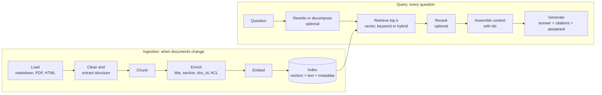
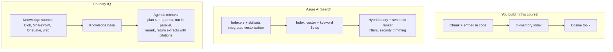
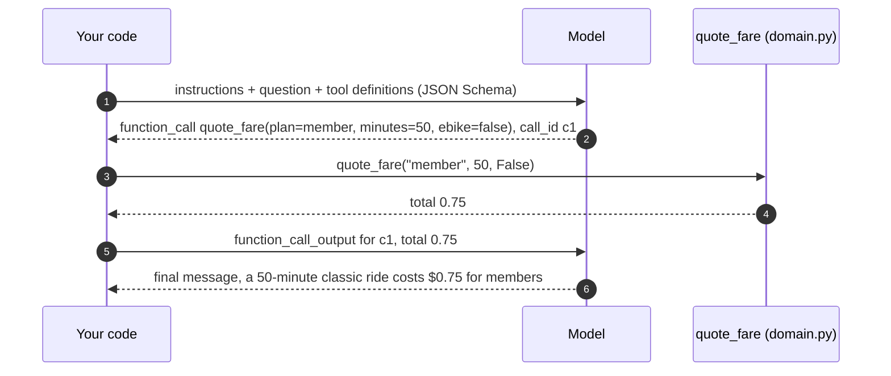

# Week 6 · Lecture notes: RAG and tool calling

[← Week 6 overview](README.md) · [Lab](lab.ipynb) · [Deep dive (optional)](deep-dive.ipynb) · [FY26 home](../README.md)

Last week the model answered from what it learned in training. This week it answers from **your** data and **your** code. The notes cover retrieval-augmented generation (RAG) from first principles to managed services on Azure, then tool calling from the wire protocol to tool design, then how Microsoft Agent Framework packages both into one agent.

**Contents**

1. [Why models need sources and tools](#1--why-models-need-sources-and-tools)
2. [Embeddings and similarity](#2--embeddings-and-similarity)
3. [The RAG pipeline](#3--the-rag-pipeline)
4. [Chunking](#4--chunking)
5. [Retrieval: vector, keyword, hybrid, reranking](#5--retrieval-vector-keyword-hybrid-reranking)
6. [Generation: grounding, citations, abstention](#6--generation-grounding-citations-abstention)
7. [Evaluating RAG](#7--evaluating-rag)
8. [RAG on Azure: AI Search, Foundry IQ, file search](#8--rag-on-azure-ai-search-foundry-iq-file-search)
9. [Tool calling: the protocol](#9--tool-calling-the-protocol)
10. [Designing tools a model uses well](#10--designing-tools-a-model-uses-well)
11. [Tools across the stack](#11--tools-across-the-stack)
12. [Agentic RAG: retrieval as a tool](#12--agentic-rag-retrieval-as-a-tool)
13. [One agent with Microsoft Agent Framework](#13--one-agent-with-microsoft-agent-framework)
14. [Summary](#14--summary)

---

## 1 · Why models need sources and tools

A model has three blind spots that no prompt can fix:

| Blind spot | Example at Lakeshore Ride | Fix |
|---|---|---|
| **Private knowledge.** It never read your documents. | "What is the lost e-bike fee?" | Retrieval (RAG) |
| **Freshness.** Its knowledge stops at a training cutoff. | "Did the student plan change this month?" | Retrieval over current documents |
| **Computation and live state.** It predicts text; it does not calculate or observe. | "What does a 50-minute ride cost?" "Are there e-bikes at LS-08 now?" | Tools: your code |

There are three ways to put knowledge into a model's answer. Know when each is right:

| Approach | How | Good for | Bad for |
|---|---|---|---|
| **Long context** ("stuff the prompt") | Put all documents in the instructions | Small, stable corpora; prototypes. Pairs well with prompt caching | Large or growing corpora: cost and latency grow with every token; quality drops as context grows |
| **RAG** | Retrieve only the relevant passages per question | Large, changing, permissioned knowledge; answers that must cite sources | Questions that need the whole corpus at once ("summarize everything") |
| **Fine-tuning** | Train the model on examples | Style, format, narrow tasks, smaller and cheaper models | Facts that change; facts you must cite. It teaches behavior, not a database |

Our handbook is ten pages: it would fit in the prompt (the Week 5 lab did exactly that to show caching). We use RAG anyway because the technique is what scales, and because citations need passages.

---

## 2 · Embeddings and similarity

An **embedding model** maps text to a vector of numbers so that texts with similar meaning point in similar directions, even with no words in common. `text-embedding-3-small` returns 1,536 numbers per text.

**Cosine similarity** measures the angle between two vectors:

$$\cos(\mathbf{a}, \mathbf{b}) = \frac{\mathbf{a} \cdot \mathbf{b}}{\lVert \mathbf{a} \rVert \, \lVert \mathbf{b} \rVert}$$

It is 1 for the same direction and near 0 for unrelated texts. These embeddings are normalized to length 1, so cosine equals the plain dot product, which is why vector indexes can compare millions of vectors quickly.

Things that matter in practice:

- **Similarity is a ranking signal, not a probability.** Scores for relevant and irrelevant passages are often close (0.62 versus 0.48). Compare scores with each other; do not hard-code "relevant above 0.7".
- **Embed queries and documents with the same model.** Vectors from different models live in different spaces.
- **Dimensions are a cost knob.** The `text-embedding-3` family accepts a `dimensions` parameter that shortens vectors with little quality loss: less storage, faster search.
- **Embeddings miss exact tokens.** Station ids (`LS-08`), fee names and product codes are often better matched by keywords. Section 5 combines both.
- **Re-embed when you change models.** An index is tied to the model that built it.

**In your service:** [`app/rag.py`](../app/rag.py) embeds every handbook section once at startup and ranks sections by cosine for each question. Offline mode replaces the model with a hashed bag-of-words vector, so tests run without Azure.

---

## 3 · The RAG pipeline

RAG has two pipelines: one runs when documents change, one runs on every question.



Everything in RAG engineering is an improvement to one of these boxes. Find which box fails before you change anything: if the right passage is not in the top *k*, no prompt will fix the answer.

---

## 4 · Chunking

A **chunk** is the unit you embed, retrieve and cite. Its size is a trade-off:

| Chunks that are… | Retrieval | Generation | Citations |
|---|---|---|---|
| Too large | Vector averages many topics; matches get vague | Lots of irrelevant text in the context | Coarse: "somewhere on this page" |
| Too small | Precise matches | Missing the sentence that gives the answer its meaning | Precise, but context is lost |

Common strategies, from simplest to most refined:

| Strategy | Idea | When |
|---|---|---|
| Fixed size with overlap | Every *n* tokens, overlapping by *m* | Unstructured text, baselines |
| **Structure-aware** | Split on headings, paragraphs, table rows | Documents with structure: our handbook (one chunk per `##` section) |
| Semantic | Split where the topic shifts, measured by embedding distance | Long prose without structure |
| Parent-child ("small to big") | Retrieve small chunks, send their larger parent section to the model | When you need precise matching *and* full context |

Always attach **metadata** to chunks: document id, title, section, date, and access-control information. Metadata powers citations, filters ("only the student plan pages") and permission trimming.

---

## 5 · Retrieval: vector, keyword, hybrid, reranking

| Method | Matches | Strength | Weakness |
|---|---|---|---|
| **Keyword** (BM25) | Shared terms, weighted by rarity | Exact ids, names, codes, numbers | Synonyms and paraphrases |
| **Vector** | Meaning | Paraphrases, other languages | Exact tokens, negation, rare ids |
| **Hybrid** | Both, fused | The best of both; the default in production | Two indexes to maintain |
| **+ Semantic reranker** | A cross-encoder rereads query and passage together | Much better ordering of the top results | Extra latency per query |

**Approximate nearest neighbor (ANN).** At scale you cannot compare a query with every vector. Indexes such as **HNSW** (hierarchical navigable small-world graphs) find near-best matches in logarithmic time, trading a little recall for a lot of speed. Exhaustive search is still the right choice for small collections like ours.

**Fusing rankings.** Hybrid search runs both searches and merges the two ranked lists with **Reciprocal Rank Fusion**: a document's score is the sum, over the lists it appears in, of

$$\text{RRF}(d) = \sum_{r \in \text{rankings}} \frac{1}{k + \text{rank}_r(d)}$$

with $k$ usually 60. RRF needs no score calibration (BM25 scores and cosine scores are on different scales), which is why Azure AI Search uses it.

**Reranking.** A bi-encoder (the embedding model) encodes the query and the passage separately; a **cross-encoder** reads them together and judges relevance much better, but is too slow to run over the whole index. So you retrieve broadly (say 50 candidates) and rerank narrowly. Azure AI Search's *semantic ranker* does this.

**How many passages?** More passages raise recall and lower precision; long contexts also bury the answer. Models attend best to the beginning and end of long inputs, the "lost in the middle" effect, so put the best passages first and keep *k* small.

---

## 6 · Generation: grounding, citations, abstention

The generation step turns passages into an answer you can trust. Three properties define "trust":

| Property | Meaning | How you get it |
|---|---|---|
| **Grounded** | Every claim is supported by a passage | Instructions: "answer only from the passages"; passages labeled with ids; low reasoning about outside knowledge |
| **Cited** | The answer says which passages support it | Structured output with a `citations` list of ids; validate ids against known documents |
| **Abstains** | It says "I don't know" when the sources are silent | A defined `abstained` flag, with a precise rule for when to set it |

Two design decisions in the lab deserve a second look:

1. **Passages go in `input`, not in `instructions`.** Retrieved text is *data*. If a document says "ignore your rules", it must be read, not obeyed. That is indirect prompt injection, and it is Week 10's main topic.
2. **Abstention is a product decision.** A false "I don't know" annoys a rider; a confident wrong answer about a fee costs money and trust. The harness checks both directions (`w06.ask.abstain`).

---

## 7 · Evaluating RAG

Evaluate retrieval and generation separately, or you will fix the wrong one.

| Stage | Metric | Question it answers |
|---|---|---|
| Retrieval | **Recall@k** | Is the right passage anywhere in the top *k*? |
| Retrieval | **MRR** (mean reciprocal rank) | How high is the first right passage, on average? |
| Retrieval | **nDCG** | Are the most relevant passages ranked highest? |
| Generation | **Groundedness** | Is every claim supported by the passages? |
| Generation | **Relevance** | Does the answer address the question? |
| Generation | **Completeness** | Is anything important missing compared to a reference answer? |
| End to end | **Abstention accuracy** | Does it decline exactly when it should? |

The harness's Week 6 checks map onto these: `w06.ask.citations` is a retrieval-plus-citation check, `w06.ask.facts` a completeness check against known facts, `w06.ask.abstain` abstention accuracy. Microsoft Foundry ships managed evaluators for the same ideas: Retrieval, Document Retrieval, Groundedness, Relevance and Response Completeness ([built-in evaluators](https://learn.microsoft.com/en-us/azure/foundry/concepts/built-in-evaluators)). Week 10 builds an LLM judge for groundedness from scratch.

---

## 8 · RAG on Azure: AI Search, Foundry IQ, file search

Our index is forty vectors in a Python list. Production RAG needs persistence, scale, freshness, filters and permissions. Azure offers three levels of "managed":



| Option | What you manage | What you get | Use when |
|---|---|---|---|
| **From scratch** | Everything | Full understanding; zero infrastructure | Teaching, tiny corpora, unit tests |
| **Azure AI Search** | Index schema, ingestion, queries | Vector, keyword and hybrid search, HNSW, semantic ranker, filters, indexers that pull from Azure data sources, integrated vectorization | You need control over the index and the query |
| **Foundry IQ** | Which sources go in a knowledge base | Automated chunking and embedding, multi-source **agentic retrieval**, extractive results with citations, ACL sync and Purview sensitivity labels, queries under the caller's identity | Agents over enterprise content with permissions |
| **File search tool** (Foundry Agent Service) | Upload files | A vector store per agent, chunked and embedded for you | Quick document Q&A inside a prompt agent |

**Agentic retrieval** is the important new idea. Instead of one query, a model plans the retrieval: it decomposes "I'm a student and my e-bike died mid-ride, what do I pay and do I get credit?" into sub-queries (student fares, e-bike battery policy, credits), runs them in parallel against one or more sources, reranks the results semantically and returns merged extracts with citations. In Foundry IQ you set a *retrieval reasoning effort* (minimal, low or medium) to trade latency for thoroughness.

**Permissions are the hard part.** In a company, two employees asking the same question must get different answers if they can read different documents. Foundry IQ synchronizes access control lists from supported sources and runs queries under the caller's Entra identity, so the agent can only retrieve what the user could open. Building that yourself is a project; buying it is usually right.

Sources: [What is Foundry IQ?](https://learn.microsoft.com/en-us/azure/foundry/agents/concepts/what-is-foundry-iq) · [Agentic retrieval in Azure AI Search](https://learn.microsoft.com/en-us/azure/search/agentic-retrieval-overview) · [Hybrid search](https://learn.microsoft.com/en-us/azure/search/hybrid-search-overview) · [Semantic ranking](https://learn.microsoft.com/en-us/azure/search/semantic-search-overview)

---

## 9 · Tool calling: the protocol

RAG gives the model text. **Tools** give it your code. The model never runs anything; it asks, and your code decides.



The pieces, in Responses API terms:

| Piece | What it is |
|---|---|
| **Tool definition** | `{"type": "function", "name", "description", "parameters": <JSON Schema>, "strict": true}` sent with the request |
| **`function_call` item** | The model's request: tool `name`, `arguments` as a JSON string, and a `call_id` |
| **`function_call_output` item** | Your result, sent back with the same `call_id` |
| **The loop** | Repeat until a response contains no `function_call` items; that response is the final answer |

Options that change behavior:

| Option | Values | Use |
|---|---|---|
| `tool_choice` | `auto` (default), `required`, `none`, or one named function | Force a lookup ("required") or forbid tools for a turn |
| `parallel_tool_calls` | true / false | Let the model request several independent calls at once ("fare **and** station") |
| `strict` | true / false per tool | Arguments always match the schema: all properties required, `additionalProperties: false` |

**Guard the loop.** A loop driven by a model needs limits: a maximum number of iterations, a maximum number of tool calls, a time budget, and errors returned *to the model* as data ("unknown station LS-99") rather than raised as exceptions. Without limits, one confused model can call tools until your quota is gone.

**Business logic stays in code.** The fare rules live in [`app/domain.py`](../app/domain.py) as deterministic Python. The model chooses *which* tool and *which* arguments; it never computes a price. This is the most important design rule of the course: let the model do language and judgment, let code do arithmetic, state and anything with money.

---

## 10 · Designing tools a model uses well

The model knows your tool only through its name, description and schema. Those are a prompt, and they deserve the same care.

| Principle | Weak | Strong |
|---|---|---|
| Names say what it does | `lookup`, `helper2` | `quote_fare`, `get_station` |
| Descriptions say **when** to use it | "Gets fares." | "Exact ride fee in US dollars for one ride. Always use this instead of computing prices." |
| Constrain arguments | `plan: string` | `plan: "single" \| "day_pass" \| "member" \| "student"` |
| Describe every argument | `minutes` | `minutes: Ride length in whole minutes.` |
| Return what the model needs, no more | The whole station database | One station's bikes, e-bikes and docks |
| Errors are data | `raise KeyError` | `{"error": "Unknown station LS-99. Ids look like LS-07."}` |
| Separate read from write | One `manage_account` tool | `get_balance` (safe) and `issue_credit` (side effect) |
| Few, distinct tools | Twenty overlapping tools | A handful, each with a clear boundary |

**Side effects need extra care.** A tool that moves money or opens tickets (Week 7's `issue_credit`, `open_ticket`) should be idempotent where possible, validated in code (amount caps, rider exists), recorded, and, for high-impact actions, require human approval. Agent Framework supports that with `approval_mode="always_require"` on a tool.

**Token budget.** Every tool definition is sent on every call. Fifty tools can cost thousands of input tokens per request and degrade tool choice. Keep tool sets small per agent (Week 7 splits them across specialists), or use tool search (Foundry toolboxes) when you truly need many.

---

## 11 · Tools across the stack

The same idea appears at three levels. Know who executes the tool, because that decides where your code, secrets and logs are.

| Kind | Example | Who executes | Where it is defined |
|---|---|---|---|
| **Function tool** (client-side) | `quote_fare`, `get_station` | Your process | Your code; the schema is sent with each request |
| **Hosted tool** (platform-side) | Code interpreter, file search, web search, Azure AI Search, image generation | Foundry, in its sandbox | Agent definition or request |
| **Remote tool over a protocol** | MCP servers, OpenAPI endpoints, A2A agents | Another service | A connection or a toolbox |

Hosted tools save you code but move execution out of your process: check data residency, cost per call and what is logged. Remote tools over MCP are Week 8's topic, when your own service becomes a tool server for other agents.

---

## 12 · Agentic RAG: retrieval as a tool

The starting `/v1/ask` retrieves **once, always**, then generates. The improved version gives the model `search_handbook` as a tool. The difference is who decides:

| | Retrieve-then-generate | Retrieval as a tool (agentic) |
|---|---|---|
| Searches | Exactly one, with the raw question | Zero, one or several, with queries the model writes |
| Multi-part questions | One query for two topics: weak | One search per topic |
| Questions that need code | Guesses | Calls `quote_fare` or `get_station` instead |
| Latency and cost | Predictable: one model call | Variable: one model call per loop iteration |
| Failure mode | Bad retrieval, confident answer | Over-searching, or not searching when it should |

Agent Framework supports both styles: retrieval as a **tool** the model calls when it chooses, or retrieval as a **context provider** that injects passages before every run. Use a context provider when every question needs the knowledge; use a tool when the model must decide.

---

## 13 · One agent with Microsoft Agent Framework

Writing the loop once teaches you how it works. Writing it in every service is how bugs happen. **Microsoft Agent Framework** (MAF) is Microsoft's open-source SDK for agents and multi-agent workflows in Python, .NET and Go, the successor to Semantic Kernel and AutoGen. This week uses its single-agent half; Week 7 uses workflows.

```python
from typing import Annotated, Literal
from agent_framework import Agent, tool
from pydantic import Field


@tool
def quote_fare(
    plan: Annotated[Literal["single", "day_pass", "member", "student"], Field(description="Rider's plan.")],
    minutes: Annotated[int, Field(description="Ride length in whole minutes.")],
    ebike: Annotated[bool, Field(description="True for an e-bike.")] = False,
) -> str:
    """Exact ride fee in US dollars for one ride. Always use this instead of computing prices."""
    ...


agent = Agent(
    client=state.models.agent_client(),  # FoundryChatClient: project endpoint + Entra ID
    name="lakeshore-ask",
    instructions=INSTRUCTIONS,
    tools=[search_handbook, quote_fare, get_station],
)
result = await agent.run(question, options={"response_format": AskAnswer})
answer: AskAnswer = result.value  # typed, validated structured output
```

What the framework does for you, and what it does not:

| It does | You still decide |
|---|---|
| Builds JSON Schema from type hints, `Literal`s, `Field` descriptions and docstrings | What the tools are, and their names and descriptions |
| Runs the loop: function calls, results, parallel calls, retries of malformed calls | The instructions: when to use each tool, when to abstain |
| Enforces limits (`max_iterations`, `max_function_calls`, time budget) through its function invocation configuration | Which limits are right for your latency and cost |
| Structured output through `response_format`, returned as `result.value` | The schema of the answer |
| Streaming (`run(..., stream=True)`), sessions (`agent.create_session()`) for multi-turn | Whether you need them (`/v1/ask` is single-turn) |
| Middleware around agent runs, model calls and tool calls | What to log, block or approve |
| OpenTelemetry spans for every run, model call and tool call | What to look at (Week 10) |
| Tool approval (`approval_mode="always_require"`) | Which tools are dangerous enough to need it |

The framework also speaks to Foundry's platform tools: `FoundryChatClient` has helpers that return hosted tool configurations (code interpreter, file search, web search, Azure AI Search, MCP) that you pass in `tools=[...]` next to your Python functions.

**In your service:** [`app/tools.py`](../app/tools.py) defines the tools with `@tool`. Each one records its call inside `recording(state)`, so the API can report `tool_calls` (Week 6) and `actions` (Week 7) from what actually ran, not from what the model claims it did. Reporting from execution, not from the model's prose, is a habit worth keeping.

Sources: [Agent Framework overview](https://learn.microsoft.com/en-us/agent-framework/overview/) · [Function calling (OpenAI)](https://developers.openai.com/api/docs/guides/function-calling) · [Writing effective tools for agents (Anthropic)](https://www.anthropic.com/engineering/writing-tools-for-agents)

---

## 14 · Summary

- Models lack private knowledge, freshness and computation. **RAG** fixes the first two; **tools** fix the third.
- RAG is **chunk, embed, retrieve, generate**. Find the failing stage before you change anything.
- Production retrieval is **hybrid** (keyword plus vector, fused with RRF) with a **reranker**.
- Trustworthy answers are **grounded, cited and abstain** when the sources are silent. Retrieved text is data, never instructions.
- Evaluate **retrieval and generation separately**.
- On Azure: **AI Search** when you want control, **Foundry IQ** for permission-aware agentic retrieval over enterprise sources, the **file search** tool for quick document Q&A.
- **Tool calling** is a loop of `function_call` and `function_call_output` items; the model asks, your code acts. Guard the loop with limits.
- **Tool design is prompt design**: names, "when to use" descriptions, constrained arguments, errors as data, read separate from write.
- **Agent Framework** runs the loop, builds schemas, enforces limits and traces everything; you still own the tools and the instructions.

## Further reading

| Topic | Resource |
|---|---|
| RAG, conceptually | [Introduction to retrieval-augmented generation concepts](https://learn.microsoft.com/en-us/training/modules/rag-fundamentals/) (module) |
| Managed knowledge for agents | [What is Foundry IQ?](https://learn.microsoft.com/en-us/azure/foundry/agents/concepts/what-is-foundry-iq) · [Build knowledge-enhanced AI agents with Foundry IQ](https://learn.microsoft.com/en-us/training/modules/introduction-foundry-iq/) (module) |
| Search engine internals | [Vector search](https://learn.microsoft.com/en-us/azure/search/vector-search-overview) · [Hybrid search](https://learn.microsoft.com/en-us/azure/search/hybrid-search-overview) · [Semantic ranking](https://learn.microsoft.com/en-us/azure/search/semantic-search-overview) · [Agentic retrieval](https://learn.microsoft.com/en-us/azure/search/agentic-retrieval-overview) |
| Tools in Foundry | [Develop generative AI apps that use tools](https://learn.microsoft.com/en-us/training/modules/use-generative-ai-tools/) (module) · [Toolbox](https://learn.microsoft.com/en-us/azure/foundry/agents/concepts/toolbox-overview) |
| The protocol | [Function calling (OpenAI)](https://developers.openai.com/api/docs/guides/function-calling) · [Vector embeddings (OpenAI)](https://developers.openai.com/api/docs/guides/embeddings) |
| Tool design | [Writing effective tools for agents (Anthropic)](https://www.anthropic.com/engineering/writing-tools-for-agents) |
| Long contexts | [Lost in the Middle: How Language Models Use Long Contexts](https://arxiv.org/abs/2307.03172) (paper) |
| Agent Framework | [Overview](https://learn.microsoft.com/en-us/agent-framework/overview/) · [GitHub](https://github.com/microsoft/agent-framework) |
