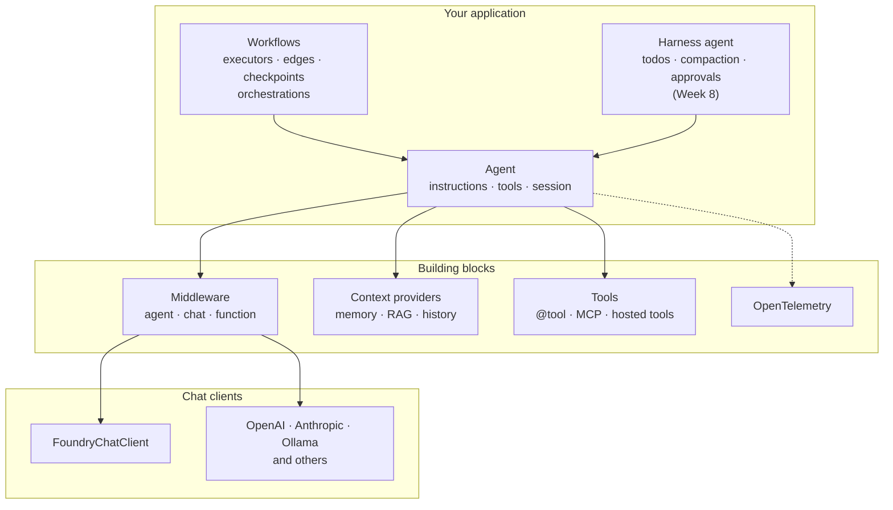
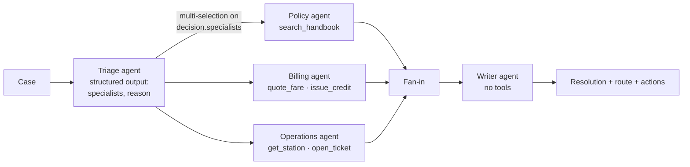
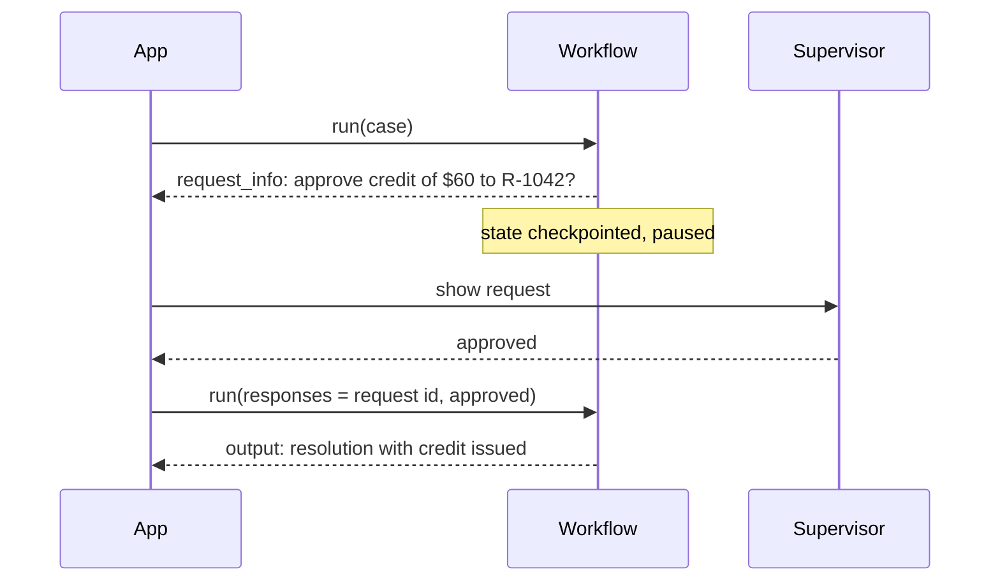
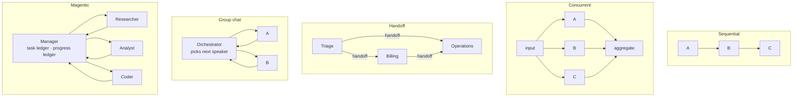

# Week 7 · Lecture notes: Multi-agent systems with Microsoft Agent Framework

[← Week 7 overview](README.md) · [Lab](lab.ipynb) · [Deep dive (optional)](deep-dive.ipynb) · [FY26 home](../README.md)

Week 6 built one agent with three tools. This week asks when one agent is not enough, and answers with **Microsoft Agent Framework** (MAF): its agent abstraction in depth, its graph-based **workflows**, and the five built-in **orchestration patterns**. You will leave able to read any MAF codebase and to argue, with numbers, whether a split into several agents paid off.

**Contents**

1. [Agents, workflows, multi-agent systems: when to split](#1--agents-workflows-multi-agent-systems-when-to-split)
2. [Microsoft Agent Framework: the map](#2--microsoft-agent-framework-the-map)
3. [The agent in depth](#3--the-agent-in-depth)
4. [Middleware: intercepting runs, model calls and tool calls](#4--middleware-intercepting-runs-model-calls-and-tool-calls)
5. [Workflows: executors, edges, supersteps](#5--workflows-executors-edges-supersteps)
6. [Routing, fan-out and fan-in in a workflow](#6--routing-fan-out-and-fan-in-in-a-workflow)
7. [Durable and interactive workflows: events, checkpoints, people](#7--durable-and-interactive-workflows-events-checkpoints-people)
8. [The five orchestration patterns](#8--the-five-orchestration-patterns)
9. [Designing the resolution team](#9--designing-the-resolution-team)
10. [Least privilege and safety for agent teams](#10--least-privilege-and-safety-for-agent-teams)
11. [Cost and latency of a team](#11--cost-and-latency-of-a-team)
12. [Observing and evaluating multi-agent systems](#12--observing-and-evaluating-multi-agent-systems)
13. [Beyond one process: Foundry, A2A, AG-UI, declarative agents](#13--beyond-one-process-foundry-a2a-ag-ui-declarative-agents)
14. [Summary](#14--summary)

---

## 1 · Agents, workflows, multi-agent systems: when to split

Three designs, in increasing order of autonomy and cost:

| Design | Who decides the next step | Strength | Weakness |
|---|---|---|---|
| **Single agent** with tools | The model, in one loop | Simple; one context; cheapest | One long prompt; every tool always available; hard to debug as it grows |
| **Workflow** | Your code: a fixed graph of steps (some of them agents) | Predictable, testable, auditable | Rigid: only handles the paths you drew |
| **Multi-agent system** | Agents decide together (handoffs, a manager, a group chat) | Flexible on open-ended tasks | More calls, more latency, more ways to fail |

Agent Framework's own rule is blunt: *if you can write a function to handle the task, do that instead of using an AI agent.* And use a workflow when the process has well-defined steps; use an agent when the task is open-ended.

Anthropic's catalog of patterns is a useful vocabulary, because each one maps to something you can build in MAF:

| Pattern | Shape | MAF construct |
|---|---|---|
| Prompt chaining | Step A's output is step B's input | `SequentialBuilder`, or edges in `WorkflowBuilder` |
| Routing | Classify, then send to one specialist | Triage agent with structured output + switch-case edges |
| Parallelization | Independent subtasks at once, then merge | `ConcurrentBuilder`, fan-out and fan-in edges |
| Orchestrator–workers | A manager plans and delegates dynamically | `MagenticBuilder`, or agents as tools |
| Evaluator–optimizer | One agent drafts, another critiques, repeat | A loop edge, or `GroupChatBuilder` with two participants |

**Reasons to split** a single agent:

1. **Instructions conflict.** "Be concise for riders" and "explain every policy clause" belong to different roles.
2. **Least privilege.** Only one role should be able to move money.
3. **Parallelism.** Independent lookups can run at the same time.
4. **Context hygiene.** A specialist sees only what it needs, so it is not distracted by everything else.
5. **Separate evaluation.** You can measure and improve each role on its own.

**Reasons not to:** each split adds model calls, latency and token cost, and creates a new failure mode at every boundary: information that one agent knew and the next did not. Practitioners disagree on how far to go. Anthropic reports that its multi-agent research system uses many times the tokens of a chat but wins on broad research tasks; Cognition argues that for tightly coupled work such as coding, a single agent with full context is more reliable. Both are right for their task. You decide with measurements, which is what this week's harness gives you.

---

## 2 · Microsoft Agent Framework: the map

MAF is Microsoft's open-source SDK for agents and multi-agent workflows in Python, .NET and Go. It is the direct successor of **Semantic Kernel** and **AutoGen**, built by the same teams: AutoGen's simple agent abstractions plus Semantic Kernel's enterprise features (sessions, type safety, middleware, telemetry), with graph-based workflows added.



The four areas, in the framework's own terms:

| Area | What it is | This course |
|---|---|---|
| **Agents** | One model with instructions, tools, session and middleware | Week 6 (`/v1/ask`) |
| **Harness agent** | An opinionated agent for long tasks: planning, todos, compaction, file memory, tool approvals | Week 8 |
| **Workflows** | Graphs of executors (functions and agents) with typed messages, plus the built-in orchestrations | This week (`/v1/resolve`) |
| **Integrations** | Model providers, Foundry agents and tools, MCP, A2A, AG-UI, DevUI, memory stores, evaluation | Throughout |

The Python packages you have installed are `agent-framework-core` (agents, tools, middleware, workflows), `agent-framework-foundry` (Foundry chat client, Foundry agents, Foundry tools, memory and evaluations) and `agent-framework-orchestrations` (the five patterns).

---

## 3 · The agent in depth

```python
from agent_framework import Agent

agent = Agent(
    client=client,  # any chat client: FoundryChatClient here
    name="billing",  # appears in traces and in multi-agent transcripts
    instructions=BILLING_RULES,  # the system message
    tools=[search_handbook, quote_fare, issue_credit],
    default_options={"reasoning": {"effort": "low"}},  # applied to every run
    context_providers=[...],  # inject memory or retrieved context before each run
    middleware=[...],  # intercept runs, model calls, tool calls (section 4)
)

result = await agent.run("Rider R-1042 ...")  # one turn
result = await agent.run(case, options={"response_format": Notes})  # typed output in result.value
async for update in agent.run(case, stream=True):  # token-by-token updates
    print(update.text, end="")
```

**Sessions carry state between turns.** An agent object is stateless and reusable; a **session** holds one conversation.

```python
session = agent.create_session()
await agent.run("My name is Ada.", session=session)
await agent.run("What is my name?", session=session)  # remembers Ada
```

Where the history lives is pluggable: in memory, in a file, in a vector store, or on the service side (a Foundry conversation). **Context providers** run before each call to add context (a user profile, retrieved passages, long-term memory) and after each call to store what was learned. RAG as a context provider and RAG as a tool are the two options from Week 6, section 12.

**Agents compose.** Two methods turn an agent into something another system can call:

| Method | Turns the agent into | Use |
|---|---|---|
| `agent.as_tool()` | A function tool another agent can call | Manager–worker without a workflow: the manager calls specialists like tools |
| `agent.as_mcp_server()` | An MCP server | Expose an agent to any MCP client (Week 8) |

**Providers are swappable.** The same `Agent` runs on `FoundryChatClient`, OpenAI, Anthropic, Ollama and others. Your instructions and tools do not change; only the client does. That is how you compare models fairly.

---

## 4 · Middleware: intercepting runs, model calls and tool calls

Middleware is code that wraps a step, sees its inputs, decides whether to continue, and sees its outputs. MAF has three layers:

| Layer | Wraps | Typical uses |
|---|---|---|
| **Agent middleware** | A whole `agent.run` | Input screening, logging, timing, caching whole answers |
| **Chat middleware** | Each model call | Redacting secrets before they leave, enforcing token budgets, swapping models |
| **Function middleware** | Each tool call | Authorization, argument validation, approvals, audit logs, rate limits per tool |

A function middleware that enforces a business rule in code, regardless of what the model asked for:

```python
from agent_framework import FunctionInvocationContext, function_middleware
from app.domain import CREDIT_LIMIT


@function_middleware
async def cap_credits(context: FunctionInvocationContext, call_next) -> None:
    if context.function.name == "issue_credit" and context.arguments["amount"] > CREDIT_LIMIT:
        context.result = f"Supervisor approval required for credits above ${CREDIT_LIMIT:.0f}."
        return  # short-circuit: the tool never runs
    await call_next()  # otherwise run the tool (and any inner middleware)


billing = Agent(
    client=client,
    name="billing",
    instructions=BILLING_RULES,
    tools=[quote_fare, issue_credit],
    middleware=[cap_credits],
)
```

Prompts *ask*; middleware *enforces*. Any rule that involves money, permissions or safety belongs in code like this, with the prompt as a second line of defense.

`CREDIT_LIMIT` is the same $25 rule used by `app/domain.py` and the handbook. This illustrative gate stops the tool call; it does not queue a review or issue a credit. The service's domain tool returns `status="escalated"` for an amount above that limit. Both are simulated action records, not a connection to a real payment system.

**Tool approval** is the built-in case of function middleware: `@tool(approval_mode="always_require")` pauses the run when the model calls the tool, returns the pending call in `result.user_input_requests`, and resumes when your code sends back an approval or rejection. The Week 7 lab does exactly this with a credit tool.

---

## 5 · Workflows: executors, edges, supersteps

A workflow is a **directed graph**. Nodes are **executors**: units of work that receive a typed message and may send messages on or yield output. Edges carry messages between executors. Agents are executors too, so the same graph can mix plain functions and agents.

```python
from typing_extensions import Never
from agent_framework import Executor, WorkflowBuilder, WorkflowContext, handler


class Normalize(Executor):
    @handler
    async def run(self, case: str, ctx: WorkflowContext[str]) -> None:
        await ctx.send_message(case.strip())  # pass a str to the next executor


class Shout(Executor):
    @handler
    async def run(self, text: str, ctx: WorkflowContext[Never, str]) -> None:
        await ctx.yield_output(text.upper())  # a workflow output, not a message


normalize, shout = Normalize(id="normalize"), Shout(id="shout")
workflow = WorkflowBuilder(start_executor=normalize).add_edge(normalize, shout).build()
result = await workflow.run("  battery died  ")
print(result.get_outputs())  # ['BATTERY DIED']
```

The ideas that make workflows different from "a few awaits in a row":

| Concept | Meaning | Why it matters |
|---|---|---|
| **Typed messages** | `WorkflowContext[Out, WorkflowOut]` declares what an executor sends and yields | The graph is validated at `build()`: an edge between incompatible types fails before anything runs |
| **Supersteps** | Execution proceeds in rounds: every executor with pending messages runs, then all messages are delivered at once | Parallel branches are deterministic; checkpoints fall on clean boundaries |
| **Outputs vs messages** | `send_message` feeds the graph; `yield_output` produces a result for the caller | One workflow can return several outputs, from several executors |
| **Agents as executors** | Pass an `Agent` where an executor is expected | Mix deterministic steps (validation, lookups) with model steps |
| **Function executors** | `@executor` turns an `async def` into an executor | Small steps without a class |
| **Functional workflows** | `@workflow` and `@step` decorators write a workflow as ordinary Python control flow | When a graph is more ceremony than you need |
| **Sub-workflows** | A `WorkflowExecutor` runs a whole workflow as one node | Reuse and encapsulation |
| **Workflow as agent** | `workflow.as_agent()` exposes the graph through the agent interface | A team can be used wherever one agent is expected, including as a tool or an MCP server |
| **Visualization** | `WorkflowViz(workflow).to_mermaid()` | Paste the graph into a README or a review |

---

## 6 · Routing, fan-out and fan-in in a workflow

The builder has one method per edge shape:

| Edge | Method | Use |
|---|---|---|
| Direct | `add_edge(a, b)` | Always go from `a` to `b` |
| Conditional | `add_edge(a, b, condition=fn)` | Go only if `fn(message)` is true |
| Switch-case | `add_switch_case_edge_group(a, [Case(condition=..., target=...), ..., Default(target=...)])` | Exactly one branch: routing |
| Multi-selection | `add_multi_selection_edge_group(...)` | Several branches chosen by a function: dynamic subsets |
| Fan-out | `add_fan_out_edges(a, [b, c, d])` | Send the same message to several executors in parallel |
| Fan-in | `add_fan_in_edges([b, c, d], e)` | Wait for all, deliver their messages to `e` together |
| Chain | `add_chain([a, b, c])` | Shorthand for a sequence |

The resolution service as an explicit graph (one of several valid designs):



The routing decision is **data** (a `TriageDecision` object), so code can log it, test it, and refuse an impossible route before any specialist runs. That is the main advantage of routing with structured output over letting agents "decide among themselves".

---

## 7 · Durable and interactive workflows: events, checkpoints, people

Real processes pause, fail and wait for people. Workflows have three mechanisms for that:

**Events and streaming.** `workflow.run(input, stream=True)` yields events as they happen: executor started and completed, agent updates, outputs, requests for input, errors. A UI can show progress; a log can record every step.

**Checkpoints.** Give the builder a `checkpoint_storage` (`InMemoryCheckpointStorage`, `FileCheckpointStorage`, or your own) and the workflow saves its state at superstep boundaries. After a crash or a deploy, `workflow.run(checkpoint_id=...)` resumes where it stopped instead of re-running (and re-paying for) every model call. Deployed as a hosted agent, the platform adds the other half: Foundry's long-running hosted agents (preview) detect a dead process and re-enter your handler with the same input, and the handler resumes from its latest checkpoint ([resilience for long-running agents](https://learn.microsoft.com/en-us/azure/foundry/agents/concepts/long-running-agent-resilience)).

**Human in the loop.** An executor calls `ctx.request_info(request, response_type)`; the workflow emits a request event and pauses. Your application collects the answer (a supervisor approves a $60 credit) and calls `workflow.run(responses={request_id: answer})`; the executor's `@response_handler` receives it and the graph continues. Orchestrations support the same through tool approvals and `with_request_info(...)`.



---

## 8 · The five orchestration patterns

`agent_framework.orchestrations` packages the common multi-agent shapes as builders that produce ordinary workflows (so they stream, checkpoint and trace like any other).



| Pattern | Builder | Control flow | Use when | Watch out for |
|---|---|---|---|---|
| **Sequential** | `SequentialBuilder(participants=[a, b, c])` | Fixed order; each sees the conversation so far | Pipelines: draft → edit → check | Latency is the sum of all steps |
| **Concurrent** | `ConcurrentBuilder(participants=[a, b, c])` | All at once on the same input; results aggregated | Independent analyses, ensembles, voting | Needs at least two participants; costs every participant on every input |
| **Handoff** | `HandoffBuilder(participants=[...]).with_start_agent(triage).add_handoff(triage, [billing, ops])` | The active agent transfers control by calling a generated handoff tool | Customer-service style routing where the path is decided turn by turn | Loops between agents; set a termination condition. Without `add_handoff` every agent can hand to every other (mesh) |
| **Group chat** | `GroupChatBuilder(participants=[...], orchestrator_agent=..., max_rounds=...)` | A shared conversation; an orchestrator (agent, function or custom) picks the next speaker | Debate, review, critique–revise loops | Token growth: everyone reads everything; cap the rounds |
| **Magentic** | `MagenticBuilder(participants=[...], manager_agent=...)` | A manager keeps a **task ledger** (facts and plan) and a **progress ledger**, delegates, re-plans when stuck | Open-ended, multi-step tasks without a known path | The most calls and the least predictable; supports plan review by a person (`with_plan_review()`) |

All builders accept `checkpoint_storage` and termination settings where they apply. The Magentic pattern comes from Microsoft Research's Magentic-One system.

**A rule of thumb for choosing:** start with the most constrained pattern that can express the task. Sequential and concurrent are graphs you can draw before you run them. Handoff, group chat and Magentic let models choose the path, which buys flexibility and costs predictability. In a graded service with money involved, constrained wins.

**The model as orchestrator.** At the far end of that spectrum, GPT-5.6 models on Foundry can delegate inside a single Responses call (preview). Pass `multi_agent={"enabled": True, "max_concurrent_subagents": 3}` and the root agent, `/root`, spawns subagents, waits for them and reconciles their findings. The coordination actions (`spawn_agent`, `wait_agent`, `interrupt_agent`, ...) come back as `multi_agent_call` items that the service executes, not your code; your own function calls, including those made by subagents, still come back to you to run. It is the least code and the least control: subagents use the same model and every tool in the request, and there is no fixed limit on the depth of the tree. The guidance is this week's: delegate only independent work, authorize every tool call no matter which agent made it, and watch the tokens. The course model, `gpt-5.4-mini`, rejects the parameter with HTTP 400 ("Multi-agent execution is not supported"). Read: [Multi-agent orchestration with the Responses API](https://learn.microsoft.com/en-us/azure/foundry/openai/how-to/responses-multi-agent).

---

## 9 · Designing the resolution team

The starting `/v1/resolve` ([`app/services/resolve.py`](../app/services/resolve.py)) fans every case out to three specialists with `ConcurrentBuilder`, then a writer drafts the reply. It works and it is wasteful. Here are the designs you could move to, with what each changes:

| Design | Model calls per case (approx.) | Route accuracy | Risk |
|---|---|---|---|
| Fan-out to all (baseline) | 3 specialists + writer, plus their tool loops | Low by construction: every specialist on every case | Specialists act on cases that are not theirs: unowed credits |
| **Triage + chosen specialists** (the lab) | 1 + 1 to 3 + 1 | As good as the triage prompt | A missed specialist means a missed action |
| Triage + handoff | 1 + chain of specialists | Good when cases need one owner | Ping-pong between agents |
| Triage + specialists + **verifier** | Above + 1 | Same | Catches wrong credits before the writer; may add new errors |
| Magentic manager | Many | Unpredictable | Overkill for a known process |

Two habits from the starting code are worth keeping in every design:

- **Actions come from execution, not from prose.** `recording(state)` captures every tool call; `actions` in the response are built from those records, not from what an agent says it did.
- **The route is reported, not inferred.** `route` lists the agents that actually ran, so the harness (and you) can compare intent with behavior.

---

## 10 · Least privilege and safety for agent teams

Give each agent the smallest tool set its job needs. In this service:

| Agent | Tools | Can it move money? | Can it change the physical world? |
|---|---|---|---|
| Triage | none | No | No |
| Policy | `search_handbook` | No | No |
| Billing | `search_handbook`, `quote_fare`, `issue_credit` | **Yes**, the only one | No |
| Operations | `get_station`, `open_ticket`, `search_handbook` | No | **Yes**: tickets send people to stations |
| Writer | none | No | No |

Layered protections for side-effect tools:

1. **Scope:** only one agent holds `issue_credit`.
2. **Validate in code:** the domain function checks the rider and the amount; middleware can cap it.
3. **Escalate by design:** credits above $25 come back `escalated` for a supervisor ([`app/domain.py`](../app/domain.py)).
4. **Approve when it matters:** `approval_mode="always_require"` for irreversible or expensive actions.
5. **Bound the run:** `max_rounds`, termination conditions, function-call limits and time budgets so a confused team stops.
6. **Record everything:** every call is in the proof and in the trace.

The writer has no tools on purpose: the component that talks to the rider cannot take actions, so a manipulated reply cannot also move money.

---

## 11 · Cost and latency of a team

Latency follows the **critical path**, cost follows the **sum**:

$$\text{latency} \approx t_\text{triage} + \max_{s \in \text{chosen}} t_s + t_\text{writer} \qquad \text{tokens} \approx \sum_{\text{all calls}} (n_\text{in} + n_\text{out})$$

Each specialist's $t_s$ itself includes its tool loop: one model call to decide, one per tool round, one to summarize. Three consequences:

- **Concurrency cuts latency, not cost.** Fan-out to three specialists costs three specialists even when it takes the time of one.
- **Triage pays for itself** when it removes at least one specialist on most cases: one small classification call saves one or two full agent loops.
- **Context grows along chains.** In sequential and group-chat patterns each agent reads everything before it; token use grows faster than the number of agents.

Your deployment's quota (Week 5: 100,000 tokens and 100 requests per minute) is shared by every call. A team that makes eight calls per case reaches 429 eight times sooner than a single call. Fewer, smaller calls is both the cheapest and the fastest optimization.

---

## 12 · Observing and evaluating multi-agent systems

**Observe.** MAF emits OpenTelemetry spans that follow the GenAI semantic conventions: one span per agent invocation (`invoke_agent`), per model call (`chat`) and per tool execution (`execute_tool`), plus spans for workflow executors. In Application Insights (Week 10) a single `/v1/resolve` request becomes a tree you can read top to bottom. For local debugging, **DevUI** (`from agent_framework.devui import serve`) gives a web UI to run agents and workflows and inspect every message and event.

**Evaluate outcomes and trajectories.** A multi-agent system can produce a good reply through a bad path (an unowed credit that the writer happened not to mention). Measure both:

| Level | Question | In this course |
|---|---|---|
| Outcome | Is the reply right? | `w07.resolve.answer` |
| Actions | Are credits and tickets exactly right, with no extra ones? | `w07.resolve.actions` |
| Route | Did the right specialists, and only those, work on the case? | `w07.resolve.route` |
| Efficiency | How many calls and seconds did it take? | `w07.latency`; the per-case table in the lab |

MAF has local evaluation helpers for the same ideas: `evaluate_agent(agent=..., queries=[...], expected_tool_calls=[...], evaluators=[...])` with checks such as `tool_called_check` and `keyword_check`. Foundry's managed agent evaluators (Task Adherence, Intent Resolution, Tool Call Accuracy, Tool Selection, Task Navigation Efficiency) score trajectories with an LLM judge at scale. Week 10 covers both.

---

## 13 · Beyond one process: Foundry, A2A, AG-UI, declarative agents

A team does not have to live in one Python process.

| Need | MAF integration |
|---|---|
| Run the agent on Foundry's managed runtime | Package it as a Foundry **hosted agent** (your container, Foundry's endpoint, identity and scaling) |
| Call an agent that already exists in Foundry | `FoundryAgent(project_endpoint=..., agent_name=...)` behaves like any MAF agent, so it can join a workflow |
| Publish a MAF agent as a Foundry prompt agent | `to_prompt_agent(agent)` converts the definition for `project.agents.create_version(...)` |
| Talk to agents built with other frameworks, across organizations | The **A2A** (Agent-to-Agent) protocol: `A2AAgent` calls a remote agent; Foundry agents can expose an A2A endpoint (A2A v1.0 is generally available in Foundry) |
| Stream agent state to a web UI | **AG-UI**: `add_agent_framework_fastapi_endpoint(...)` exposes an agent or workflow to AG-UI front ends |
| Define agents and workflows in configuration | Declarative YAML loaded with `AgentFactory` and `WorkflowFactory` |
| Expose a team as a tool server | `workflow.as_agent().as_mcp_server()` (Week 8) |

This is the main reason to learn a framework rather than hand-rolled loops: the same agent definition can move from a notebook to your container to Foundry's runtime, and talk to agents written by others, without a rewrite.

---

## 14 · Summary

- Split an agent for **conflicting instructions, least privilege, parallelism, context hygiene or separate evaluation**, and only when the measurement says it pays.
- **MAF** = agents + harness agent + workflows + integrations; successor to Semantic Kernel and AutoGen.
- An **agent** is a client, instructions, tools, options, context providers and middleware; **sessions** hold conversations; agents compose as tools and MCP servers.
- **Middleware enforces** what prompts can only request: approvals, caps, redaction, audit.
- **Workflows** are typed graphs of executors run in supersteps; edges express sequence, conditions, switch-case routing, fan-out and fan-in; they stream events, checkpoint and pause for people.
- Five **orchestrations**: sequential, concurrent, handoff, group chat, Magentic. Prefer the most constrained one that fits.
- Make **routing data** (structured triage), report **actions from execution**, give side effects to **one** agent.
- **Latency follows the critical path, cost follows the sum.**
- Evaluate **outcomes, actions, routes and efficiency**, not just the final text.

## Further reading

| Topic | Resource |
|---|---|
| The framework | [Agent Framework overview](https://learn.microsoft.com/en-us/agent-framework/overview/) · [GitHub](https://github.com/microsoft/agent-framework) |
| Workflows | [Workflow capabilities](https://learn.microsoft.com/en-us/agent-framework/workflows/) · [Orchestrations](https://learn.microsoft.com/en-us/agent-framework/workflows/orchestrations/) |
| Approvals | [Tool approval in Agent Framework](https://learn.microsoft.com/en-us/agent-framework/agents/tools/tool-approval) |
| Patterns and when to use them | [Building effective agents (Anthropic)](https://www.anthropic.com/engineering/building-effective-agents) |
| The case for many agents | [How we built our multi-agent research system (Anthropic)](https://www.anthropic.com/engineering/multi-agent-research-system) |
| The case against | [Don't build multi-agents (Cognition)](https://cognition.ai/blog/dont-build-multi-agents) |
| Learn modules | [Orchestrate a multi-agent solution using the Microsoft Agent Framework](https://learn.microsoft.com/en-us/training/modules/orchestrate-semantic-kernel-multi-agent-solution/) · [Develop AI Agents on Azure](https://learn.microsoft.com/en-us/training/paths/develop-ai-agents-azure/) |
| Managed runtime | [Hosted agents in Foundry Agent Service](https://learn.microsoft.com/en-us/azure/foundry/agents/concepts/hosted-agents) |
| Model-native delegation | [Multi-agent orchestration with the Responses API](https://learn.microsoft.com/en-us/azure/foundry/openai/how-to/responses-multi-agent) (preview) |
| Certification | [Exam AI-500: Designing and Implementing Multi-Agent AI Solutions](https://learn.microsoft.com/en-us/credentials/certifications/exams/ai-500/) |
