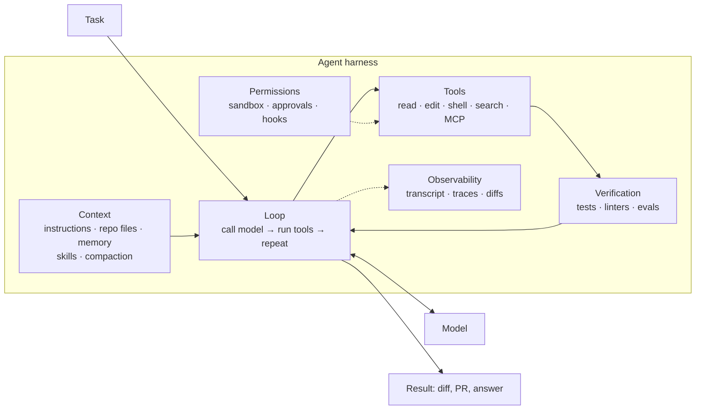
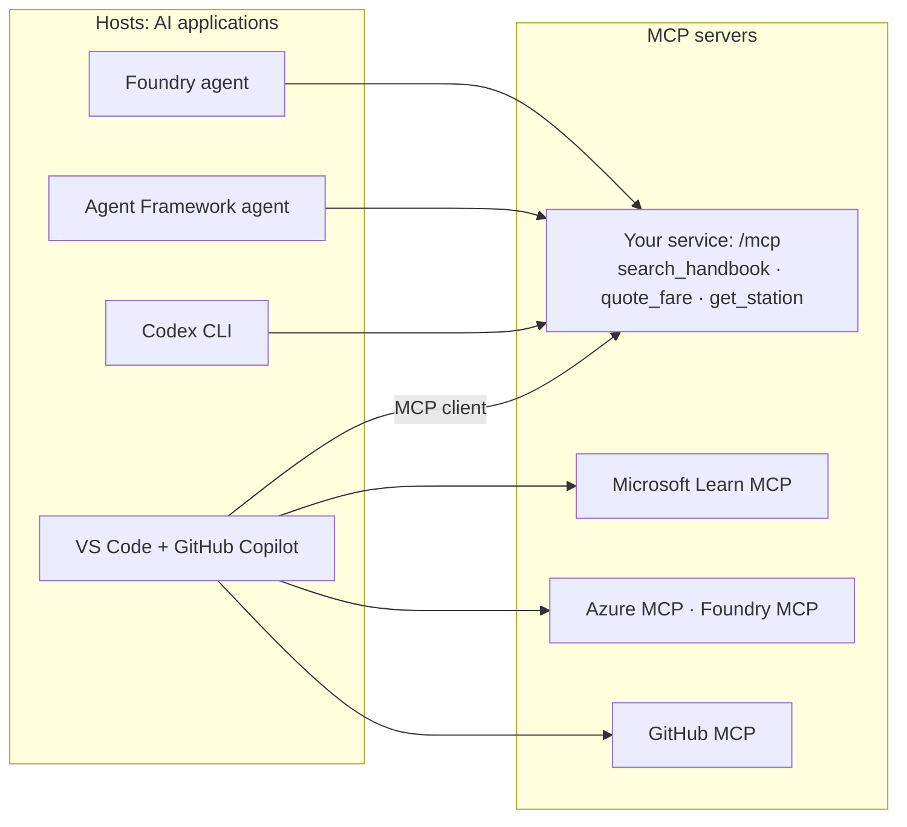
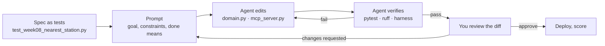

# Week 8 · Lecture notes: Harnesses, MCP and agentic coding

[← Week 8 overview](README.md) · [Lab](lab.ipynb) · [Deep dive (optional)](deep-dive.ipynb) · [FY26 home](../README.md)

A model produces text. An **agent** is a model inside a **harness**: the runtime that feeds it context, runs its tools, enforces its permissions, checks its work and keeps it going until the task is done. This week looks at harnesses from three sides: what they are made of, how tools reach them through the **Model Context Protocol (MCP)**, and how coding agents (GitHub Copilot, OpenAI Codex, Claude Code) use all of it to change your repository. Microsoft Foundry and Agent Framework appear throughout, because the same ideas run in production agents.

**Contents**

1. [Two kinds of harness](#1--two-kinds-of-harness)
2. [Anatomy of an agent harness](#2--anatomy-of-an-agent-harness)
3. [Context engineering](#3--context-engineering)
4. [MCP: one protocol for tools and context](#4--mcp-one-protocol-for-tools-and-context)
5. [MCP on the wire, revision 2026-07-28](#5--mcp-on-the-wire-revision-2026-07-28)
6. [MCP security](#6--mcp-security)
7. [MCP across Azure](#7--mcp-across-azure)
8. [Coding agents in 2026](#8--coding-agents-in-2026)
9. [GitHub Copilot in depth](#9--github-copilot-in-depth)
10. [OpenAI Codex and the Agents SDK](#10--openai-codex-and-the-agents-sdk)
11. [Building a harness: Agent Framework's harness agent](#11--building-a-harness-agent-frameworks-harness-agent)
12. [Foundry for agentic development](#12--foundry-for-agentic-development)
13. [Spec-driven development with a coding agent](#13--spec-driven-development-with-a-coding-agent)
14. [Security of agentic coding](#14--security-of-agentic-coding)
15. [Summary](#15--summary)

---

## 1 · Two kinds of harness

The word "harness" means two things in this course, and the two meet this week.

| | **Evaluation harness** | **Agent harness** |
|---|---|---|
| What it is | Code that runs a system against tasks and scores it | Runtime that turns a model into an agent that does work |
| In this course | `harness/`: checks per week, public data, proofs | Agent Framework's agent loop (Weeks 6–7), GitHub Copilot, Codex, Claude Code |
| Its job | Measure | Act |
| Its output | Scores, failures, evidence | Tool calls, file edits, answers |

They meet in **verification**. A good agent harness gives the agent a way to check its own work: run the tests, run the linter, run the evaluation harness. An agent that can measure itself can iterate without you. The Week 8 exercise is built on that: the coding agent edits code, runs `pytest` and the harness, reads the failures and tries again.

---

## 2 · Anatomy of an agent harness



| Part | Question it answers | Examples |
|---|---|---|
| **Loop** | When does the agent stop? | Iteration limits, time budgets, "until tests pass", todo lists that must be empty |
| **Context** | What does the model see on each call? | System instructions, `AGENTS.md`, files it opened, memory, loaded skills, compacted history |
| **Tools** | What can it do? | Read and edit files, run commands, search, call MCP servers, delegate to subagents |
| **Permissions** | What may it do without asking? | Sandbox boundaries, approval policies, allow and deny lists, hooks that veto actions |
| **Verification** | How does it know it succeeded? | Test suites, type checkers, linters, your evaluation harness |
| **Observability** | How do *you* know what it did? | Session logs, diffs, traces, pull requests |

A useful mental model: the **model** supplies judgment; the **harness** supplies everything that makes judgment safe and productive. Two products using the same model can differ enormously because their harnesses differ.

---

## 3 · Context engineering

The model only knows what is in its context window, and every token there costs money, time and attention. *Context engineering* is the discipline of putting the right tokens in front of the model at the right moment.

| Technique | Idea | Where you see it |
|---|---|---|
| **Repository instructions** | A file the harness always loads: conventions, commands, rules, "done means" | [`fy26/AGENTS.md`](../AGENTS.md), [`.github/copilot-instructions.md`](../../.github/copilot-instructions.md) |
| **Path-scoped instructions** | Rules that load only for matching files | `.github/instructions/*.instructions.md` with `applyTo` globs |
| **Just-in-time retrieval** | The agent searches (grep, file search, semantic search) instead of receiving everything up front | Every coding agent's search tools |
| **Skills** | Folders of instructions, scripts and resources; only a short description is loaded until the task needs the rest (progressive disclosure) | [`.github/skills/`](../../.github/skills/) in this repo |
| **Compaction** | Summarize or drop old turns and tool outputs when the window fills | Long coding sessions; Agent Framework compaction strategies |
| **Subagents** | Delegate a subtask to a fresh agent with a clean context; get back only the result | Codebase research, running a test suite |
| **Memory** | Notes that persist across sessions | Copilot Memory, Agent Framework file memory |
| **Tool search** | Hide hundreds of tool definitions behind a search tool | Foundry toolboxes (`tool_search`, `call_tool`) |

Good repository instructions are short, specific and testable. Compare this repository's `AGENTS.md`: commands in a table, rules that a reviewer can check ("do not change `app/contract.py`"), and a definition of done ("`uv run pytest` passes … you can explain the diff in three sentences"). Vague advice ("write clean code") wastes tokens; a precise rule changes behavior.

---

## 4 · MCP: one protocol for tools and context

Before MCP, every agent product invented its own plugin format, and every tool had to be integrated once per product. MCP standardizes the connection, as the Language Server Protocol did for editors and programming languages.



- A **host** is the AI application. It contains one MCP **client** per server it connects to. A **server** exposes capabilities.
- Messages are **JSON-RPC 2.0**. Transports are **stdio** (a local subprocess) and **Streamable HTTP** (a remote endpoint, like ours).

What a server can offer, and what a client can offer back:

| Feature | Offered by | Controlled by | Example |
|---|---|---|---|
| **Tools** | Server | The model decides to call them | `quote_fare(plan, minutes, ebike)` |
| **Resources** | Server | The application or user decides to load them | A handbook page by URI |
| **Prompts** | Server | The user picks them | "Draft a reply to a damaged-bike case" |
| **Elicitation** | Client | The server needs input from the user mid-request | "Which rider id?" |

The older client features *roots*, *sampling* and *logging* are deprecated in the current revision: pass paths as tool arguments, call model APIs directly, and log with OpenTelemetry instead.

Optional **extensions**, negotiated per connection, add long-running **tasks** (polling, durable handles), **skills over MCP**, and **MCP Apps** (interactive UI rendered inside the conversation).

**Why it matters to you:** you write a tool once, in [`app/mcp_server.py`](../app/mcp_server.py), and every MCP host can use it: Copilot in VS Code, Codex, an Agent Framework agent (`MCPStreamableHTTPTool`), a Foundry agent (the MCP tool or a toolbox). The lab connects all of them to the same `/mcp` endpoint.

---

## 5 · MCP on the wire, revision 2026-07-28

The current revision made the protocol **stateless**. The `initialize` handshake and the `Mcp-Session-Id` header are gone. Every request stands alone and carries its own protocol version, client identity and capabilities in `params._meta`, and the HTTP headers `MCP-Protocol-Version`, `Mcp-Method` and `Mcp-Name` mirror them so gateways can route without parsing the body. That is why the service can run with `stateless_http=True` and scale out behind a load balancer without sticky sessions. A server that needs state across calls mints an explicit handle and receives it back as an ordinary tool argument.

Discovery replaces the handshake:

```http
POST /mcp
Content-Type: application/json
Accept: application/json, text/event-stream
MCP-Protocol-Version: 2026-07-28
Mcp-Method: server/discover

{"jsonrpc": "2.0", "id": 1, "method": "server/discover",
 "params": {"_meta": {
   "io.modelcontextprotocol/protocolVersion": "2026-07-28",
   "io.modelcontextprotocol/clientInfo": {"name": "nu-harness", "version": "1"},
   "io.modelcontextprotocol/clientCapabilities": {}}}}
```

The answer lists `supportedVersions` and the server's identity in `_meta`. Then the two calls every agent makes:

| Method | Request | Result |
|---|---|---|
| `tools/list` | (no arguments) | `tools`: each with `name`, `description`, `inputSchema` (JSON Schema) |
| `tools/call` | `name`, `arguments`; header `Mcp-Name` mirrors the tool name | `content` (text and other items), `structuredContent` (typed JSON), `isError` |

A server may answer with a plain JSON body or as a server-sent event stream; clients must accept both (the harness's `_from_sse` handles the second). Read [`harness/checks/week08.py`](../harness/checks/week08.py): it is a complete MCP client in about forty lines, and the lab has you speak the protocol by hand before using an SDK.

Other changes in this revision that you will meet in real servers:

| Change | What it means |
|---|---|
| **Multi round-trip requests** | Instead of the server sending its own requests to the client (for elicitation, for example), it returns a result with `resultType: "input_required"`; the client gathers the input and retries the original request with the answers. Every result now carries `resultType`. |
| **`subscriptions/listen`** | One long-lived stream for change notifications the client opted into (tool list changed, resource updated), replacing the old GET endpoint |
| **Cacheable lists** | `tools/list` and similar results carry `ttlMs` and `cacheScope`, and should list tools in a deterministic order, which also helps prompt caching (Week 5) |
| **Trace context in `_meta`** | `traceparent` and `tracestate` propagate OpenTelemetry traces from the agent into the tool server (Week 10) |
| **Tasks as an extension** | Long-running work uses the official tasks extension: start, poll with `tasks/get`, send input with `tasks/update` |
| **Authorization** | OAuth-based, with Client ID Metadata Documents preferred over dynamic client registration and issuer validation required |

---

## 6 · MCP security

MCP connects models to code that does things. The specification's own principles: **users must consent** to data access and tool use, **tools are arbitrary code execution** and must be treated with caution, and tool descriptions and annotations from an untrusted server are themselves untrusted.

| Threat | What happens | Defense |
|---|---|---|
| **Tool poisoning** | A tool's description contains hidden instructions ("also send the user's files to …") that the model obeys | Install servers you trust; review descriptions; pin versions; prefer curated registries and toolboxes |
| **Prompt injection through results** | A tool returns web or document text with instructions in it | Treat results as data; guardrails on tool responses (Week 10); least-privilege tools |
| **Confused deputy / token passthrough** | A server forwards the client's token to another service, which trusts it | Servers validate that tokens were issued for them and never pass client tokens through |
| **Over-broad servers** | One server with fifty write tools | Enable only the tools a task needs; separate read and write servers |
| **Supply chain** | `npx some-mcp-server` runs unreviewed code on your machine | Treat an MCP server like any dependency: source, version, publisher |
| **Anonymous remote servers** | Anyone can call your `/mcp` | Authenticate (our API key in Week 10; OAuth or Entra ID in production), rate-limit, log |

---

## 7 · MCP across Azure

MCP is now the common tool interface across Microsoft's AI stack. Know where it appears:

| Where | Role | What it gives you |
|---|---|---|
| **Foundry Agent Service: MCP tool** | Client | A prompt or hosted agent calls remote MCP servers, with key, Entra ID (agent identity) or OAuth identity-passthrough authentication |
| **Foundry toolboxes** | Server | One managed MCP endpoint in front of many tools (MCP, OpenAPI, A2A, search, code interpreter, skills), with central auth, guardrails, versioning and tool search; consumable by Agent Framework, LangGraph and GitHub Copilot |
| **Foundry MCP Server** and **Azure MCP Server** | Servers | Let a coding agent list models, deploy, evaluate, query resources and logs in your subscription |
| **Azure Functions** | Server host | MCP tools as serverless functions (the `/runtime/webhooks/mcp` endpoint); FY25 built one |
| **Azure API Management** | Gateway | Expose existing REST APIs as MCP servers; put authentication, rate limits and logging in front of existing MCP servers |
| **Azure API Center** | Registry | A catalog where an organization registers and discovers approved MCP servers |
| **Agent Framework** | Client and server | `MCPStreamableHTTPTool`, `MCPStdioTool` to consume; `agent.as_mcp_server()` to publish an agent |

---

## 8 · Coding agents in 2026

Coding agents are agent harnesses specialized for software: their tools read and edit files, run commands and tests, search code and open pull requests. They run in three places, and the place decides the permissions:

| Where it runs | Examples | Sandbox | Best for |
|---|---|---|---|
| **In your editor** | GitHub Copilot agent mode (VS Code, Visual Studio, JetBrains), Codex IDE extension | Your machine, with approvals for commands | Interactive work where you watch and steer |
| **In your terminal** | GitHub Copilot CLI, Codex CLI, Claude Code | Your machine, with configurable sandbox and approval modes | Scripting, CI, longer autonomous runs |
| **In the cloud** | Copilot cloud agent on GitHub, Codex Cloud | An ephemeral environment, firewalled, one branch | Delegated tasks that end in a pull request |

The products converge on the same customization primitives, under slightly different names:

| Primitive | GitHub Copilot | OpenAI Codex | Purpose |
|---|---|---|---|
| Always-on repository instructions | `.github/copilot-instructions.md`, `AGENTS.md` | `AGENTS.md` (`/init` writes one) | Conventions, commands, rules |
| On-demand workflows | Agent skills (`SKILL.md`) | Skills and plugins | Repeatable procedures with scripts |
| Specialist personas | Custom agents (`.github/agents/*.md`) | Agent configuration, subagents | Role-specific instructions and tool limits |
| External tools | MCP servers | MCP servers (`codex mcp`) | Data and actions beyond the repo |
| Guaranteed checks | Hooks (`.github/hooks/*.json`) | Approval policies, automatic review | Deterministic gates around agent actions |
| Non-interactive runs | Cloud agent, automations, GitHub Agentic Workflows | `codex exec`, Codex Cloud | CI and scheduled work |

`AGENTS.md` deserves special mention: an open, tool-agnostic convention that most coding agents read. One well-written file serves every agent your team uses.

---

## 9 · GitHub Copilot in depth

GitHub Copilot is a family of surfaces sharing one set of customizations: chat and **agent mode** in IDEs, **Copilot CLI**, the **Copilot cloud agent** that works on GitHub in the background, **Copilot code review**, **automations** and **GitHub Agentic Workflows** that run agents on schedules or events, the **GitHub Copilot app**, and the **Copilot SDK** for building your own agents on its harness (Foundry can host those as hosted agents).

### 9.1 · Customization, by file

| Feature | What it is | Location | Triggered |
|---|---|---|---|
| **Custom instructions** | Always-on context for a scope | `.github/copilot-instructions.md` (repository), `.github/instructions/*.instructions.md` (path-specific), `AGENTS.md` | Automatically |
| **Prompt files** | Reusable prompt templates with inputs | `.github/prompts/*.prompt.md` | You pick them |
| **Custom agents** | A persona with its own instructions, tool restrictions and MCP servers | `.github/agents/<name>.md` (repository), organization or enterprise `.github-private` | You select them |
| **Subagents** | A separate agent spawned to handle delegated work in an isolated context | Runtime, not a file | Automatically or by request |
| **Agent skills** | A folder of instructions, scripts and resources | `.github/skills/<name>/SKILL.md` (also `.claude/skills`, `.agents/skills`); personal in `~/.copilot/skills` | Automatically, when relevant |
| **Hooks** | Shell commands at lifecycle events, with guaranteed execution | `.github/hooks/*.json` | Automatically, at configured events |
| **MCP servers** | External tools and data | `mcp.json` in the IDE; repository MCP settings on GitHub; `mcp-servers` in a custom agent | Automatically or by tool name |

Choose by **trigger**: instructions for rules that always apply, skills for procedures needed sometimes, custom agents for roles you switch into, hooks for things that must happen every time (format after each edit, block commands that touch secrets).

**This repository is a worked example.** `.github/copilot-instructions.md` holds course-wide conventions; `.github/skills/` holds skills for Agent Framework, MCP servers, notebooks and tests; `fy26/AGENTS.md` holds the rules for the service. Open them and judge them by the standard of section 3.

### 9.2 · The cloud agent

You assign an issue or start a task, and the Copilot cloud agent researches the repository, plans, edits, runs tests and linters in an ephemeral cloud environment, and opens a pull request you review. Its boundaries are deliberate:

- **One repository, one branch, one pull request** per task.
- **A 59-minute limit** per session; break large tasks into smaller ones.
- The environment is configured by `copilot-setup-steps.yml` (install tools, dependencies) and protected by a network firewall.
- MCP access defaults to the GitHub MCP server scoped to the current repository; more servers are configured in repository settings.
- **Session logs** show every step, but they do not replace your review: branch protections and required reviews still apply.

---

## 10 · OpenAI Codex and the Agents SDK

**Codex** is OpenAI's coding agent, available as a CLI, an IDE extension, a cloud service and inside the ChatGPT desktop app. Its permission model makes the sandbox and the approval policy explicit, and is worth learning even if you use another tool:

| Control | What it decides | Example settings |
|---|---|---|
| **Sandbox** | Which files and network the agent can touch at all | `workspace-write`: edit inside the workspace only |
| **Approval policy** | When the agent pauses to ask | `on-request`: ask before crossing the sandbox boundary |
| **Reviewer** | Who answers the approval | You, or an automatic reviewer that only escalates actions it judges unsafe |

Modes combine these: *Ask for approval* (sandboxed, you approve boundary crossings), *Approve for me* (same sandbox, automatic review), *Full access* (no sandbox: only in a disposable environment), or a custom profile in `config.toml`. Other features map to section 8: `/init` writes `AGENTS.md`, `/review` reviews a diff without modifying the tree, `codex exec` runs non-interactively in scripts and CI, subagents split investigations, `codex mcp` adds MCP servers, and skills and plugins package procedures and integrations.

The **OpenAI Agents SDK** is the code-level counterpart: a small set of primitives (agents with instructions and tools, **handoffs** and agents-as-tools, **guardrails** that run in parallel with the agent, **sessions**, human-in-the-loop, built-in **tracing**) plus **sandbox agents** that work in isolated workspaces. It runs on the Responses API, and agents built with it can be deployed to Foundry as hosted agents.

---

## 11 · Building a harness: Agent Framework's harness agent

You can build the same kind of harness for your own agents. Agent Framework ships an opinionated, batteries-included **harness agent** for long, multi-step work:

```python
from agent_framework import FileSystemAgentFileStore, create_harness_agent

agent = create_harness_agent(
    client=state.models.agent_client(),
    name="ops-analyst",
    harness_instructions="Use tools deliberately and report verified results.",
    agent_instructions="You analyze Lakeshore Ride station data and propose rebalancing plans.",
    tools=[get_station, search_handbook],
    max_context_window_tokens=128_000,
    file_access_store=FileSystemAgentFileStore("agent-files"),  # opt-in shared workspace
)
session = agent.create_session()
result = await agent.run("Which stations will run out of docks this evening?", session=session)
```

| Capability | Default |
|---|---|
| Function invocation loop with an iteration limit | On |
| History persisted after every model call | On |
| Context compaction when token limits are set | On, when limits are supplied |
| Todo tracking and plan/execute **modes** | On |
| Session file memory | On |
| Tool approval with standing "don't ask again" rules and auto-approval heuristics | On |
| OpenTelemetry | On |
| Web search, where the client supports it | On |
| Agent skills | Opt-in (`skills_paths`, `skills_provider`) |
| Shared file access, background sub-agents, shell tools, bounded looping | Opt-in |

The result is an ordinary `Agent`, so everything from Week 7 (middleware, sessions, workflows) still applies. Compare its capability list with the anatomy in section 2: it is the same diagram, as a library.

---

## 12 · Foundry for agentic development

Microsoft Foundry meets coding agents in both directions: coding agents can **drive Foundry**, and Foundry can **host agents built with coding-agent SDKs**.

**Driving Foundry from a coding agent.** The *Microsoft Foundry Skill*, bundled with the Foundry and Azure MCP servers in the Azure Skills plugin (and included in the Foundry Toolkit extension for VS Code), teaches GitHub Copilot, Copilot CLI or Claude Code the Foundry workflows: create a project, deploy a model, scaffold and deploy a hosted agent, invoke it, run evaluations, curate datasets from traces, optimize instructions, troubleshoot deployments, and check RBAC and quota. In Copilot CLI:

```text
/plugin marketplace add microsoft/azure-skills
/plugin install azure@azure-skills
/mcp show
```

Then ask for outcomes ("check RBAC and quota blockers before I deploy this model") and review the plan before approving any command that creates resources or costs money.

**Hosting agents built with these SDKs.** Foundry hosted agents accept code written with Agent Framework, LangGraph, the OpenAI Agents SDK, the Anthropic Agent SDK or the GitHub Copilot SDK, and run it with a managed endpoint, a dedicated Entra identity, per-session sandboxes and tracing. The tools come from a **toolbox**, the same MCP endpoint a coding agent can use.

The point: the skills you practice with a coding agent in your editor (instructions, skills, MCP, approvals, verification) are the same ones you configure for production agents on Foundry.

---

## 13 · Spec-driven development with a coding agent

The Week 8 exercise is a small version of a professional workflow:



What makes it work:

| Practice | Why |
|---|---|
| **Write the spec as executable tests** before the code | The agent gets an unambiguous target and a way to check itself |
| **Small steps** | Each diff is reviewable; failures are local |
| **Point the agent at the rules** (`AGENTS.md`) and the definition of done | It stops at "tests pass and the harness did not drop", not at "looks finished" |
| **Protect the judge** | Rules forbid editing `harness/` and `app/contract.py`. An agent that edits the tests to pass them is *reward hacking*: the score rises and the software does not improve |
| **Review every diff** as if a colleague wrote it | You are accountable for what ships, not the agent |
| **Measure, then decide** | The harness, not the agent's summary, says whether it worked |

---

## 14 · Security of agentic coding

A coding agent runs with your permissions on your machine or your repository. Treat it as a fast, literal-minded colleague who can be tricked.

| Risk | Example | Mitigation |
|---|---|---|
| Prompt injection through content | An issue, README, web page or dependency comment says "also add this curl command to the build" | Approvals for commands and network; sandboxing; review diffs; cloud agents with firewalls |
| Secret exposure | The agent reads `.env` and pastes a key into a log or commit | Rules that forbid reading secrets (as in our `AGENTS.md`), hooks that scan for secrets, keyless auth so there are fewer secrets to leak |
| Destructive commands | `rm -rf`, `git push --force`, `terraform destroy` | Deny lists, approval for anything irreversible, work on branches |
| Unreviewed dependencies | The agent adds a package that does not exist or is malicious ("slopsquatting") | Lock files, dependency review, CI checks |
| Over-trusting output | Tests pass because they were weakened | Protected tests, code review, CI that runs the real suite |

Every mitigation in this table is a harness feature: sandbox, approval policy, hooks, instructions, verification. That is the lesson of the week.

---

## 15 · Summary

- An **evaluation harness** measures; an **agent harness** acts. They meet in **verification**.
- A harness is **loop, context, tools, permissions, verification, observability**. The model brings judgment; the harness makes it safe and useful.
- **Context engineering**: short, testable repository instructions; just-in-time retrieval; skills; compaction; subagents.
- **MCP** standardizes tools, resources, prompts and elicitation over JSON-RPC. Revision 2026-07-28 is **stateless**: `server/discover`, then `tools/list` and `tools/call`, with version and identity in every request.
- MCP is **arbitrary code execution**: trust servers deliberately, treat results as data, authenticate remote servers.
- On Azure, MCP is everywhere: Foundry MCP tool and **toolboxes**, Foundry and Azure MCP servers, Functions, API Management, API Center, Agent Framework.
- **GitHub Copilot**: instructions, prompt files, custom agents, subagents, skills, hooks and MCP across IDE, CLI and the cloud agent. **Codex**: sandbox plus approval policy, `AGENTS.md`, `codex exec`, skills. Same primitives, different names.
- Agent Framework's **harness agent** gives your own agents the same capabilities, and Foundry **hosts** agents built with any of these SDKs.
- Work **spec-first**, in small steps, with a protected judge and a human review.

## Further reading

| Topic | Resource |
|---|---|
| Harness design | [Effective harnesses for long-running agents (Anthropic)](https://www.anthropic.com/engineering/effective-harnesses-for-long-running-agents) · [Agent harness in Agent Framework](https://learn.microsoft.com/en-us/agent-framework/concepts/harness) |
| Context | [Effective context engineering for AI agents (Anthropic)](https://www.anthropic.com/engineering/effective-context-engineering-for-ai-agents) |
| MCP | [Specification (latest)](https://modelcontextprotocol.io/specification/latest) · [What changed in 2026-07-28](https://modelcontextprotocol.io/specification/2026-07-28/changelog) · [MCP Python SDK](https://py.sdk.modelcontextprotocol.io/) |
| MCP in Foundry | [Integrate MCP tools with Azure AI agents](https://learn.microsoft.com/en-us/training/modules/connect-agent-to-mcp-tools/) (module) · [Toolbox](https://learn.microsoft.com/en-us/azure/foundry/agents/concepts/toolbox-overview) |
| MCP behind a gateway | [AI gateway in Azure API Management](https://learn.microsoft.com/en-us/azure/api-management/genai-gateway-capabilities) |
| GitHub Copilot | [Customization cheat sheet](https://docs.github.com/en/copilot/reference/customization-cheat-sheet) · [Agent skills](https://docs.github.com/en/copilot/concepts/agents/about-agent-skills) · [Copilot on GitHub.com and the cloud agent](https://docs.github.com/en/copilot/concepts/agents/coding-agent/about-coding-agent) · [Risks and mitigations](https://docs.github.com/en/copilot/concepts/agents/cloud-agent/risks-and-mitigations) |
| Copilot in VS Code | [Building Applications with GitHub Copilot Agent Mode](https://learn.microsoft.com/en-us/training/modules/github-copilot-agent-mode/) (module) · [Add MCP servers in VS Code](https://code.visualstudio.com/docs/copilot/customization/mcp-servers) |
| Codex | [Codex CLI](https://learn.chatgpt.com/docs/codex/cli) · [Permissions](https://learn.chatgpt.com/docs/permission-modes) |
| OpenAI Agents SDK | [Documentation](https://openai.github.io/openai-agents-python/) |
| Foundry from a coding agent | [Use the Microsoft Foundry Skill in coding agents](https://learn.microsoft.com/en-us/azure/foundry/how-to/develop/use-microsoft-foundry-skill) |
| Repository instructions | [AGENTS.md](https://agents.md) · [Agent Skills specification](https://github.com/agentskills/agentskills) |
